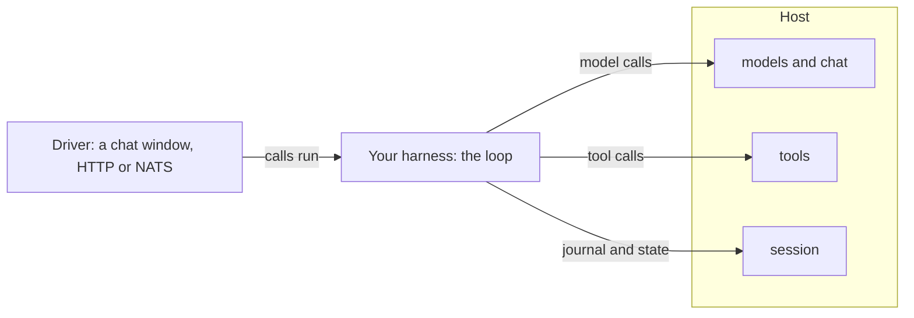
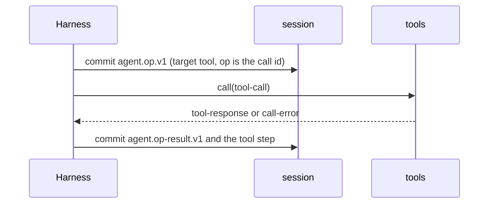

# Build your own agent harness

An agent harness is the loop at the center of an agent. It sends the conversation to a model, runs the tools the model asks for, records what happened and repeats until it has a reply.

In this guide you build a harness on `cosmonic:agent@0.4.2`, or port an existing loop onto it. You will choose a world, implement `run`, call the model and tools through the host, handle calls whose outcome is unknown, compact long conversations, then build, test and run the component.

The examples come from two reference harnesses in this repository:

- [`components/minimal-agent`](../../components/minimal-agent), a small harness in about 2,300 lines of Rust
- [`harnesses/codex`](../../harnesses/codex), Codex's agent loop ported from openai/codex

## How a harness fits

You write only the loop. The host makes the model calls, holds the keys, runs the tools and keeps the session. Your component starts with no network, no files and no credentials.



The driver is whatever starts a run. It belongs to the host, and so do the interfaces your harness imports, in three groups: model access, tools and session storage. [Portability](portability.md) explains which of the rules in this guide hold on every host.

## 1. Choose a world

A world is the list of what your component imports and exports. Pick one from [`world.wit`](../../wit/cosmonic-agent/world.wit):

- **`runnable-agent`**: the `agent` imports plus the `run` export. Start here. A host drives your harness through `run`, so it needs no HTTP handler or protocol of its own.
- **`compactable-agent`**: `runnable-agent` plus `compact`, so a driver can ask for a summary between runs. Add it once you compact (step 6).
- **`agent`** alone: the imports with no export. Use it only if you serve another entry point yourself.

`run`, `run-types` and `compact` are unstable. They sit behind the `agent-run` feature, so their shape may still change.

Spell the world out in your own WIT file, as minimal-agent's [`wit/world.wit`](../../components/minimal-agent/wit/world.wit) does. A reviewer then reads every import and export in one place:

```wit
world minimal-agent {
  import cosmonic:agent/inference-types@0.4.2;
  import cosmonic:agent/models@0.4.2;
  import cosmonic:agent/chat@0.4.2;
  import cosmonic:agent/session@0.4.2;
  import cosmonic:agent/tools@0.4.2;

  export cosmonic:agent/run@0.4.2;
}
```

Fetch the package with `wash wit fetch` or `wkg`, with `WKG_CONFIG_FILE` pointing at [`wit/wkg-registries.toml`](../../wit/wkg-registries.toml). Commit the resulting `wkg.lock` so the dependency is pinned by digest.

## 2. Implement `run`

`run` must return quickly. Once it has committed the person's message, it hands back a stream of events and a future for the outcome, and keeps working in the background. This is minimal-agent's [`src/run.rs`](../../components/minimal-agent/src/run.rs), abridged:

```rust
// Abridged.
async fn run(message: UserMessage, options: RunOptions) -> Result<StartedRun, WitStartError> {
    let req = validate(message, options).map_err(WitStartError::InvalidInput)?;
    let accepted = turn::accept(&req).await.map_err(|e| match e { /* busy, duplicate, unavailable */ })?;

    let (events_tx, events_rx) = wit_stream::new::<RunEvent>();
    let (outcome_tx, outcome_rx) = wit_future::new::<Result<RunOutcome, RunError>>(|| {
        Err(RunError::Failed("the agent stopped before the run ended".into()))
    });
    wit_bindgen::spawn_local(async move {
        let mut events = Events(events_tx);
        let ended = turn::run(&mut events, &req, accepted).await;
        drop(events); // the stream closes before the outcome resolves
        let _ = outcome_tx.write(ended.map(outcome).map_err(run_error)).await;
    });
    Ok((events_rx, outcome_rx))
}
```

### Validate first

Validate before you write anything. minimal-agent refuses these as `invalid-input`:

- an empty message
- a `run-id` too long to fit in the commit id
- a schema that is not JSON
- attachments by URL

### Accept the run

`accept` does three things, in order:

1. **Take the lock.** One run at a time per session. Return `busy` if a run is already in progress. The driver holds the real lock, and yours is a backstop.
2. **Read the session** with `session.current()`, and close any ops a crashed run left open (step 5). An op is a model or tool call recorded in the journal.
3. **Commit the opening.** Write the person's `agent.step.v1` and an `agent.run.v1` entry (`{"run": "<run-id>"}`), with `commit-id` set to `run:<run-id>`. If the session already holds that commit id, return `duplicate`.

### Run the loop

Call the model, run the tools it asks for, add the results and repeat. While the loop runs:

- **Stream a `step` event** for each message the run adds. Commit the message first where you can, so the event's `seq` matches the journal. Skip the person's opening message, because the driver already has it.
- **Stream `counts`** after each model call.
- **Stop when the driver drops the event stream.** A failed write to the stream tells you.

To end the run, write `agent.run-result.v1` (`run`, `outcome`, and `finish` or the error case) in the commit that ends it. Then resolve the outcome.

Hold nothing in memory between runs. The next run may land on a fresh instance, and your conversation lives in the session's state and journal.

## 3. Call the model through the host

Open the model by alias, never by name. The host decides what `default` means for this workload:

```rust
let model = models::open("default".to_string()).await?;
```

`models.describe(alias)` reports what the host knows about the model, including `context-length`, which you need for compaction.

`chat` takes the messages as a stream that you write while the call is pending, plus a future that says the conversation is complete. From [`src/model.rs`](../../components/minimal-agent/src/model.rs):

```rust
let (mut msg_tx, msg_rx) = wit_stream::new();
let (done_tx, done_rx) = wit_future::new(|| Err("the agent stopped writing".to_string()));
wit_bindgen::spawn_local(async move {
    let unwritten = msg_tx.write_all(messages).await;
    drop(msg_tx);
    let _ = done_tx.write(if unwritten.is_empty() { Ok(()) } else { Err("messages lost".into()) }).await;
});
let (mut chunks, outcome) = chat::chat(model, msg_rx, done_rx, options).await?;
while let Some(chunk) = chunks.next().await { /* stream text and reasoning deltas */ }
let completion = outcome.await?;
```

Follow these rules on every call:

- **Drain the chunks before you await the outcome.** Dropping the chunk stream cancels generation.
- **Tell the two error kinds apart.** An error before the host accepts the call is a `request-error`, such as `context-length-exceeded`. An error after is a `generation-error`.
- **Continue on `pause-turn`.** When `finish-reason` is `pause-turn`, append the reply and call again.
- **Pass the run's settings on.** Put the run's `effort` and `trace-parent` in `chat-options`.
- **Record the call.** Commit `agent.op.v1` (`target: "model"`, a fresh op id) before it, and `agent.op-result.v1` after.

## 4. Call tools

### List, offer and relay

List the tools at the start of each run and offer them to the model. `tools.list` returns `tool-types.tool-def`. `chat-options.tools` takes the `inference-types.tool-def` the model sees, which has no annotations or version. From [`src/tools.rs`](../../components/minimal-agent/src/tools.rs):

```rust
for t in tools::list().await? {
    offered.read_only.push((t.name.clone(), t.annotations.read_only));
    offered.defs.push(ToolDef {
        name: t.name,
        title: t.title,
        description: t.description,
        input: t.input,
        output_schema: t.output_schema,
    });
}
```

If listing fails, record an `error` step and carry on without tools. Never read the failure as "no tools".

When the model replies with tool calls, pass each `tool-call` to `tools.call` exactly as it came, with the same id, name and arguments. Never parse or rebuild the arguments:

- A `json` argument is checked by the host against the tool's schema.
- A `text` argument, for a `grammar` or `text` tool, is the model's raw text and must never be parsed as JSON.

### Typed tools

You never write tool definitions for typed tools. A typed tool is a component that exports an ordinary WIT interface, such as [`components/units-tool`](../../components/units-tool). The host reads that interface and builds a `tool-def` for each eligible function:

- **Eligible functions** are in interfaces outside `wasi:*` and `cosmonic:agent/*`, with no resources, streams or futures in the signature.
- **The name** is the function name in snake case.
- **The description** is the function's doc comment.
- **The arguments** are the fields of the function's only parameter, when that parameter is a record, with the field comments as argument descriptions.

A built component keeps its types but not its comments, so the descriptions come from the tool's published WIT package. units-tool builds that package with `wasm-tools component wit wit --wasm -o units-wit.wasm`. The [design note](../../wit/cosmonic-agent/README.md#what-makes-a-component-a-tool) has the full rules, and [Write a typed tool](https://cosmonic.com/docs/agent-sdk/write-a-typed-tool/) walks through building one.

To your harness, a typed tool and a tool provider look the same: a `tool-def` in and a `tool-response` out. You relay, and the host translates.

### Record every call

Journal each tool call around its dispatch. The op must be in the journal before the call goes out, so a restart knows the call may have happened.



Record the outcome like this:

| `tools.call` result | `agent.op-result.v1` outcome | What the model reads |
| --- | --- | --- |
| `ok`, `is-error: false` | `succeeded` | The output |
| `ok`, `is-error: true` | `failed` | The output, as a normal result it can react to |
| `not-dispatched(...)` | `cancelled` | Why it didn't run, so it may try again |
| `outcome-unknown(...)` | `unresolved` | See step 5 |

The conventions in [`session.wit`](../../wit/cosmonic-agent/session.wit) reserve `failed` for a call that returned, and `cancelled` for one that was never dispatched. minimal-agent records `not-dispatched` as `failed`; prefer `cancelled` in your own harness.

## 5. Handle unknown outcomes and timeouts

`outcome-unknown` means the call may have taken effect. The connection dropped after dispatch, the call was cancelled while running, or its deadline passed (`timed-out`). The email may have been sent. The file may have been written.

### The rules

The session rules in [`session.wit`](../../wit/cosmonic-agent/session.wit) are strict:

- Never advance state past an unresolved op.
- Repeat a tool call with the same id and arguments only when workload configuration authorizes repeat detection. Tool annotations cannot authorize it.
- Never use a new id to get around an unresolved tool call.

### Stop the run

minimal-agent records the call as `unresolved`, sends its result to the driver and fails the run. It makes no more model calls and no more tool calls, and saves no conversation past that point.

If the run went on, the model would read "this may not have worked" and very likely call the tool again with a new id. That is exactly the repeat the rules forbid: the second email, the second payment. Stopping hands the decision to a person, who can check whether the first call took effect. The failure text says so: the call "was not made again; check whether it took effect before asking again".

### The read-only exception

minimal-agent makes one exception. When `outcome-unknown(timed-out)` comes from a tool whose `read-only` annotation is `true`, it closes the op as `failed`, gives the model the timeout text and carries on. A missing annotation counts as not read only.

This is a trade-off. The annotation is the provider's unchecked claim, so a tool wrongly marked read only could have written something the run then moves past. If you want no trade-off, fail on every unknown outcome.

### Word the timeout

A timeout carries no text ([#4](https://github.com/cosmonic-labs/agent-sdk/issues/4) proposes a payload), so the harness writes the words the model reads. You can reuse `tool_timed_out` in [`src/describe.rs`](../../components/minimal-agent/src/describe.rs). It tells the model not to repeat the same call and to ask for less in one call: a narrower query, a smaller folder, fewer items, one page at a time.

### Recover after a restart

Read the journal from the entry after the state's `through`, or from the start when there is no state, and close any op that has no result. minimal-agent's [`src/journal.rs`](../../components/minimal-agent/src/journal.rs) closes them this way:

- **A model op** closes as `cancelled`, because a model call can simply be made again.
- **A tool op** closes as `unresolved`, with an `error` step naming it, and is never made again.

### Apply run limits to tool calls

When `max-duration` passes while minimal-agent is working through a reply's tool calls, it makes no further calls. Each remaining call gets an error result ("Not called: the run's time limit passed"), so every call the model made has an answer.

## 6. Compact

Long conversations outgrow the model's context window, the amount of text it can read in one call. Compaction asks the model to summarize older context and replaces that context with the summary, keeping recent messages word for word. You choose when to compact. The contract fixes how it is recorded.

- **When.** Compact before a model call when the context passes your threshold (`trigger` `threshold`), after a call refused with `context-length-exceeded` (`overflow`), or when the driver calls `compact` (`requested`). The Codex harness uses 90% of `context-length` from `models.describe` as its threshold.
- **The summary call** is a model op like any other. It counts against `max-steps`, `max-total-tokens` and `max-duration`.
- **One commit** holds `agent.compaction.v1` (`summary`, `model`, `trigger`, `through`, `kept`, token estimates) and the smaller state, plus `agent.compact-result.v1` for a requested compaction. After that commit, stream the `compacted` run event.
- **Never commit a refused or filtered summary.** Close its op as failed and keep the old state.
- **The summary is model output.** Put it back as an assistant message behind a fixed preamble, never as system or person text.

To serve `compact`, accept by committing `agent.compact.v1` under the commit id `compact:<id>` before the model call. End every accepted compaction with at most one `agent.compact-result.v1`. A driver treats a compaction with no result as failed. `focus` is the person's text: give it to the summarizer as their request, never as instructions. [`compact.wit`](../../wit/cosmonic-agent/compact.wit) has the full rules.

minimal-agent does not summarize. When the model's context is full, it drops the oldest half of the stored conversation and retries once, within `max-steps`. That is enough for a reference harness, but it loses context a summary would keep.

## 7. Build it

### Rust

minimal-agent builds with `wash build`, which runs `wash wit fetch` and then `cargo build --target wasm32-wasip2 --release`. These pieces matter:

- **Rust 1.94 or newer.** Its bundled `wasm-component-ld` writes the WASI 0.3 component type section.
- **`wit-bindgen` 0.62 with `async-spawn`, and `wasip3` 0.9,** pinned so both share one async runtime. `wit-bindgen` versions before 0.59 trap on Wasmtime 48.
- **The unstable feature, enabled in the bindings:**

```rust
wit_bindgen::generate!({
    path: "wit",
    world: "minimal-agent",
    features: ["agent-run"],
    generate_all,
});
```

### Notes for JavaScript

A JavaScript loop can run on QuickJS, a small JavaScript engine, built into a WASI 0.3 component by [componentize-qjs](https://github.com/andreiltd/componentize-qjs). Neither reference harness here is JavaScript, so this section lists what to expect rather than a full build. Plan for these when you port an existing JavaScript agent loop:

- **Replace the provider, not the framework.** Most JavaScript agent frameworks have an extension point for a model provider. Write one that calls `cosmonic:agent/chat` instead of opening a socket, and keep the rest of the framework unmodified.
- **Export by interface name.** `export { runExport as run }` serves `cosmonic:agent/run`. A function returning a WIT `result` returns the `ok` value, or throws an `Error` whose `payload` is the `err` variant.
- **Remove the feature gate in a copy of the WIT.** componentize-qjs cannot enable a WIT feature, so build from a copy of the WIT with the `@unstable` gate removed. The component's types are the same either way.
- **Check the initializer.** componentize-qjs snapshots the component at build time. Some versions cannot snapshot a component that imports async host functions ([componentize-qjs#101](https://github.com/andreiltd/componentize-qjs/issues/101)) or serves HTTP, so you may need to patch the tool.
- **Compose away the filesystem.** The QuickJS runtime links wasi-libc's filesystem support whether or not you use it. Compose a small component that exports an empty filesystem in front of the harness (`wac compose`), so the result imports none.
- **Use real timers and real randomness.** QuickJS has no timers of its own. Make `setTimeout` an actual `wasi:clocks` wait, or cancellation and streaming starve. Take ids from `wasi:random`, never `Math.random`, whose state is frozen into the snapshot every instance starts from.

## 8. Test it locally

- **Unit tests** cover the parts of a run that need no host: `cargo test` in minimal-agent, or plain Node tests for rules you keep free of host imports.
- **A scripted host** runs the built component end to end. [`components/minimal-agent/test-host`](../../components/minimal-agent/test-host) and [`harnesses/shared/test-host`](../../harnesses/shared/test-host) are small [Wasmtime](https://wasmtime.dev) hosts that play the model, the session store and a few tools. They start runs on fresh instances, so anything kept in memory is gone, as it can be on a real host. They need no model credentials:

  ```shell
  cd components/minimal-agent/test-host
  cargo run -- ../target/wasm32-wasip2/release/minimal_agent.wasm
  ```

  Script the cases that matter: a cancelled run, a duplicate `run-id`, a tool that times out and a restart in the middle of a tool call.
- **Check the reach** on every build. `wasm-tools component wit <component.wasm>` lists every import and export. Fail the build on anything you did not intend, such as `wasi:http/client`, `wasi:sockets` or `wasi:filesystem`. An allowlist is safer than a denylist, because a new import then needs a deliberate change. [`harnesses/shared/scripts/check-harness.mjs`](../../harnesses/shared/scripts/check-harness.mjs) is one you can copy.

## 9. Run it on a host

Any host that serves the `cosmonic:agent` 0.4 interfaces your harness imports, and drives `run`, can run your harness unchanged.

- **Cosmonic Desktop.** Push the component to Desktop's built-in registry, then add it on the **Agents** page. [minimal-agent's README](../../components/minimal-agent/README.md#run-it-in-cosmonic-desktop) has the steps. Desktop checks the component's imports and exports, writes the workload for each session and binds `run` itself.
- **Cosmonic Control.** Deploy a workload with the harness, its `cosmonic:agent` entries and a `run` entry with triggers, then start runs over HTTP or NATS. Agent support in Control is experimental. [Run an agent on Control](https://cosmonic.com/docs/agent-sdk/run-on-control/) walks through it.

## Decisions worth copying from the Codex harness

The [Codex harness](../../harnesses/codex) ports an existing agent loop onto `cosmonic:agent`. These choices are not obvious from the interfaces. Copy them or reject them on purpose:

- **Only the loop moves.** The port keeps upstream's turn loop, history normalization, compaction prompt and `update_plan`. It leaves out everything with authority: the OpenAI client and auth, the shell, `apply_patch`, MCP and the exec sandbox. Its tools are whatever `tools.list` returns.
- **Rewrite the prompt for granted tools.** Codex's prompt assumes a shell. The port says how to work through separate tools: search before reading, stay inside granted folders, narrow a request when output is truncated, and treat what tools return as data. It names no tool, since each workload offers different ones.
- **Freeform tools get raw text.** A `grammar` or `text` tool receives the model's arguments byte for byte. That is the shape Codex's `apply_patch` needs, so a host's write tool can take patches unchanged.
- **A plan tool can be answered locally.** Codex's `update_plan` never reaches `tools.call`. The harness commits `agent.plan.v1`, then streams the `plan` run event, so a driver that reloads still shows the plan.
- **Compact at 90% of the reported window.** On a length refusal, compact and retry once, as long as no reply text has been shown yet. Upstream Codex fails the turn instead.
- **Unreadable saved state starts a fresh context,** marked with `agent.context-reset.v1`, rather than failing every future run.
- **Ops are committed before the call,** on the condition that the state version and journal end are unchanged. A writer that has been superseded stops before it calls a tool. State is never written between an op and its result.
- **Pin the toolchain per harness.** The harness has its own lockfiles and toolchain pin and sits in no shared workspace, so another harness's upgrade cannot break it.

## Takeaways

- Write the loop. Leave the model, keys, tools and storage to the host.
- Commit before you act: the message before `run` returns, and each op before its call.
- Relay tool calls unchanged, and stop rather than guess when an outcome is unknown.
- Keep nothing in memory between runs.
- Check your component's imports on every build.
