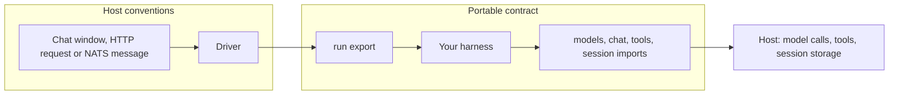

# Portability: what every host shares

An agent harness built on `cosmonic:agent` runs on any host that serves the interfaces it imports and drives the export it serves. A host is the runtime that runs your component, makes model calls for it, keeps its session and runs its tools. [Cosmonic Desktop](https://cosmonic.com/desktop/) and [Cosmonic Control](https://cosmonic.com/control/) are two hosts.

This guide separates the contract, which is the same on every host, from the conventions each host adds around it. Read it to learn what your harness can rely on everywhere, what to look up for each host, and how to check a harness before you move it.

## The short version

Your component's imports and exports are the contract. How a run gets started, what a workload manifest says and which keys configure the host are conventions.



| Portable: the same on every host | Host convention: varies by host |
| --- | --- |
| The `cosmonic:agent` packages, interfaces and worlds | How a run is triggered (chat window, HTTP, messaging) |
| What `run` and `compact` mean, and the events and outcomes they produce | Request formats, headers, labels and subjects |
| Tool calls, tool errors and tool input kinds | Which components a session offers as tools, and the names the model sees |
| The session journal, its conditional commits and its reserved entry kinds | Where the session is stored and how it is encrypted |
| The capability rule: a component reaches only what it imports and is granted | The manifest keys that grant those interfaces |
| Versioning and compatibility rules | Default limits, deadlines and caps |

## The portable contract

### Packages and worlds

`cosmonic:agent` is a WIT package. WIT (WebAssembly Interface Types) is the interface language components are built against. The current release is `cosmonic:agent@0.4.2`. It is defined in [`wit/cosmonic-agent`](../../wit/cosmonic-agent) and published to `ghcr.io/cosmonic-labs/cosmonic/agent`.

A world is the full list of what a component imports and exports. These are the worlds a harness author uses, from [`world.wit`](../../wit/cosmonic-agent/world.wit):

| World | Stability | Imports | Exports | For |
| --- | --- | --- | --- | --- |
| `agent` | stable | `inference-types`, `models`, `chat`, `tools`, `session` | nothing | What a harness may use |
| `runnable-agent` | unstable (`agent-run`) | everything in `agent` | `run` | A harness a host drives |
| `compactable-agent` | unstable (`agent-run`) | everything in `agent` | `run`, `compact` | A harness that also summarizes on request |
| `run-client` | unstable (`agent-run`) | `run` | nothing | A driver, protocol adapter or test double |
| `compact-client` | unstable (`agent-run`) | `run`, `compact` | nothing | A driver for a `compactable-agent` |
| `tool-provider` | stable | nothing | `tools` | A tool that lists its own definitions and parses JSON itself |

The package also defines provider worlds (`inference-provider`, `inference-client`, `chat-provider`, `embeddings-provider`) for trusted components that serve models. A harness never targets them.

### A run

A run is one unit of work: the person's message comes in, the agent loops through model and tool calls, and a reply goes out. Chat interfaces call it a turn. `run` is defined in [`run.wit`](../../wit/cosmonic-agent/run.wit), with its types in [`run-types.wit`](../../wit/cosmonic-agent/run-types.wit):

```wit
run: async func(
    message: user-message,
    options: run-options,
) -> result<started-run, start-error>;
```

The driver is whatever calls `run`. These rules hold on every host:

- **Acceptance.** `run` returns once the harness has committed the person's message and an `agent.run.v1` entry to the session, under the commit id `run:<run-id>`. A refusal (`start-error`: `busy`, `duplicate`, `invalid-input`, `unavailable`, `other`) writes nothing.
- **Progress, then outcome.** `started-run` is a stream of `run-event`s (`text-delta`, `reasoning-delta`, `step`, `counts`, `compacted`, `plan`, `other`) and a future that resolves to a `run-outcome` or a `run-error`. The stream closes before the future resolves.
- **Cancellation.** Dropping the event stream asks the harness to stop. The harness ends its calls, records them and resolves `cancelled` once nothing of the run is still running.
- **One run at a time per session.** The driver serializes runs. The harness's `busy` answer is a backstop.
- **The host chooses the session.** `run` takes no session handle, so a driver cannot point a run at someone else's conversation.
- **Limits.** The harness enforces `max-steps`, `max-total-tokens` and `max-duration` from `run-options`, so it can end with a reply (`finish`: `max-steps`, `max-total-tokens`, `max-duration`). A driver also enforces what it can meter itself.
- **No in-memory state between runs.** The next run may land on a fresh instance. Everything needed to continue is in the session.
- **Approvals belong to the host.** A harness never receives or answers an approval. A held tool call waits, then returns a result or `not-dispatched(denied)`. When nobody can answer a question, the run ends with `finish` `input-required`.

`compact`, defined in [`compact.wit`](../../wit/cosmonic-agent/compact.wit), follows the same lock and cancellation rules. It summarizes older context between runs, at the driver's request.

### Tool calls

`tools` has two functions. `list` returns `tool-def`s, and `call` takes the model's `tool-call` as it came and returns a `tool-response`. A harness imports this interface and a tool provider exports it. It is defined in [`tools.wit`](../../wit/cosmonic-agent/tools.wit), with its records in [`tool-types.wit`](../../wit/cosmonic-agent/tool-types.wit).

- **Input kinds.** A tool's input is a `tool-input`: `json-schema`, `grammar` (text a Lark or regular expression grammar constrains) or `text`. A call's arguments are a `tool-arguments`: `json` for a JSON Schema tool, and `text` for the other two, which is never parsed as JSON.
- **Failures the model sees.** A tool that ran and failed returns `tool-response.is-error`. The model reads it as a normal result.
- **Failures the harness handles.** `call-error` says what is known. `not-dispatched` means this attempt had no effect. `outcome-unknown` means it may have.
- **Listing errors.** `list` fails with `list-error` rather than returning an empty list, so "no tools" and "couldn't list" are different answers.
- **Truncation.** The host may truncate output and append a note with the original size.
- **Annotations.** `tool-annotations` (`read-only`, `destructive`, `idempotent`, `open-world`) are the provider's claims, for display. They authorize nothing.
- **Reserved names.** `find_tools` and `load_tools` are reserved for a host's own discovery tools.

A typed tool exports its own WIT interface and nothing from `cosmonic:agent`. The host turns its functions into `tool-def`s and translates JSON into typed calls. The harness never sees the difference: it receives `tool-def`s and relays `tool-call`s either way.

The [design note](../../wit/cosmonic-agent/README.md#what-makes-a-component-a-tool) describes how a host builds those definitions: snake case names, record fields as arguments and doc comments as descriptions. These are translation rules, not WIT types, and a host may present a different name to the model. A harness must not hard-code tool names it did not list.

### The session journal

`session`, defined in [`session.wit`](../../wit/cosmonic-agent/session.wit), is an append-only journal plus opaque working state that the host keeps for the harness.

A commit appends entries and can replace the state in the same atomic step. It can carry conditions: `require-state` (the state is still the version you read) and `require-end` (nothing was appended since you read). When a condition no longer holds, the commit writes nothing and returns the current snapshot, so one writer never overwrites another. The writer then reconciles or stops; minimal-agent ends the run `superseded`. A `commit-id` makes a retried commit safe.

Every `agent.*` entry kind is reserved, and each entry's data is JSON. A host, or a tool a person uses, can redraw a conversation from these entries alone:

| Kind | Holds |
| --- | --- |
| `agent.step.v1` | A message: `role` (user, assistant, tool, error), `text`, `blocks`, `tools`, and `run` when a run wrote it |
| `agent.op.v1` | A model or tool call before it starts: `op`, `target`, `name`, tool `arguments` |
| `agent.op-result.v1` | The call's end: `op` and `outcome` (`succeeded`, `failed`, `cancelled`, `unresolved`) |
| `agent.run.v1` / `agent.run-result.v1` | A run's opening and its ending (`outcome` with `finish` or the error case) |
| `agent.compact.v1` / `agent.compact-result.v1` | A requested compaction's opening and its ending |
| `agent.compaction.v1` | A summary that replaced older context: `summary`, `model`, `trigger`, `through`, `kept`, token estimates |
| `agent.plan.v1` | The agent's whole current plan, replacing any earlier one |
| `agent.context-reset.v1` | Saved state could not be read, so the harness started a fresh context |

Writers may define other kinds. Readers skip kinds and fields they do not understand.

### Compaction

Compaction replaces older context with a summary the model writes, so the next model call fits in the model's context window. The contract fixes how compaction is recorded, not when the harness does it:

- `trigger` says why it happened: `threshold` (the harness's own limit), `overflow` (a model call was refused for length) or `requested` (the driver called `compact`).
- The summary call is an op like any model call. `agent.compaction.v1` lands in one commit with the smaller state.
- A refused or filtered summary is never committed.
- Earlier entries stay in the journal. The summary is model output, never system or person text.

### Capabilities

A component reaches only what its world imports and its host grants. A harness on the `agent` world imports a model by alias, its tools and its session, and nothing else: no endpoint, no key, no network and no files. Exporting `run` adds no power, because an export is something others call, not something the component can use.

You can check a built component's reach on any machine:

```shell
wasm-tools component wit target/wasm32-wasip2/release/minimal_agent.wasm
```

Some language runtimes bring extra imports. Rust's standard library adds `wasi:cli`, `wasi:io` and `wasi:clocks` 0.2 imports to print a panic message, and none of them reaches the network or the filesystem. A host may refuse a harness that imports more than this, and each host decides what reach it grants each import.

### Versioning and compatibility

These rules extend the [design note's versioning rules](../../wit/cosmonic-agent/README.md#versioning):

- **Breaking changes bump the minor version** (0.4 to 0.5). Adding a case to a variant, a field to a record, or a function to an interface a guest exports (`tools`, `run`) breaks compiled consumers.
- **Additive changes bump the patch version** (0.4.0 to 0.4.1) and carry `@since` on the new items. New interfaces, and new functions on interfaces the host serves, are additive.
- **Patch versions link to each other.** A harness built against 0.4.2 links to a host entry that names 0.4.0 or 0.4.1, as long as the host serves every interface the harness imports, including the unstable ones.
- **Published versions never change.**
- **Unstable items may still change.** Items behind `@unstable(feature = ...)` are outside these promises. The one feature today is `agent-run`, which gates `run`, `run-types`, `compact` and the worlds that use them. A consumer sees these items only when it enables the feature (in Rust, `features: ["agent-run"]` in `wit_bindgen::generate!`).
- **A release that changes only unstable items takes a patch bump,** even when the change would break a consumer of those items. Code that uses no unstable feature sees no change. Code that enables one has opted into breakage: rebuild against the new patch release and check what moved.

Two things follow for a harness:

- Handle every case of every variant, including the `other` case where a variant defines one, and never parse their detail strings.
- Pin the version you build against. Expect to rebuild for a minor version, or for any release if you enable an unstable feature.

Tool discovery needs no new interface. A host that offers it adds its own `find_tools` and `load_tools` tools to `tools.list`, and the harness calls them like any other tool. Interfaces for spawning child agents are in design and not part of any release.

## Host conventions

Everything in this section is a host's choice. Two hosts serving the same `cosmonic:agent` version can differ here and both be correct.

### How runs start

The contract says a driver calls `run`. Each host decides who that driver is and what reaches it:

- **A chat interface.** Cosmonic Desktop drives `run` from its Agents page. Desktop adds the `run` binding to the agent's workload itself and refuses a manifest that names `run` (see [minimal-agent's README](../../components/minimal-agent/README.md#run-it-in-cosmonic-desktop)).
- **HTTP.** A host can accept requests in a public format and translate them into `run` calls. Cosmonic Control accepts requests in the OpenAI Responses API format at `/v1/responses` and streams server-sent events. It maps `input` onto the `user-message`, and fields such as `instructions` and `reasoning.effort` onto `run-options` (see [Run an agent on Control](https://cosmonic.com/docs/agent-sdk/run-on-control/)).
- **Messaging.** Control also starts runs from NATS requests on a subject per workload, with the same JSON body. Agent support in Control is experimental.
- **An adapter component.** A component on the `run-client` world can import `run` and serve another protocol itself.

The response format, status codes, cancellation endpoints, authentication and default deadlines all belong to the host. For example, Control answers a second concurrent request with `409 busy`. None of this changes what your harness sees: one `run` call with a `user-message` and `run-options`.

### Tools and their names

Each host decides which components a session offers as tools. A host may also:

- present a different name to the model than the function name
- cap output
- set a deadline for each call (Control documents 30 seconds)
- add its own tools, such as a question for the person, or `find_tools` and `load_tools`

Read the tool list on every run, and use names exactly as the host gave them.

### Sessions

The host decides where the journal is stored, how it is encrypted and when it is deleted. It also decides whether to bind one session per workload or one per conversation.

Limits such as entry size, session size and the length of a `commit-id` belong to the host too. A harness learns about them through `session.error.too-large` or a refused commit. Keep run ids short to leave room for the `run:` prefix.

### Labels, headers and metadata

`request-meta` in `chat-options` carries `trace-parent`, `labels` and cache hints that a host may use or ignore. Labels on the host side, such as the node label Control uses to place agent workloads, never reach the component.

## One manifest, many hosts

A wasmCloud workload manifest says which components run together and what each is granted. It is a `Workload` or `WorkloadDeployment` resource in `runtime.wasmcloud.dev/v1alpha1`. For an agent it lists:

- the harness component
- any tool components
- one `hostInterfaces` entry for each group of `cosmonic:agent` interfaces, each granted to named components

[`components/minimal-agent/manifests/workload.yaml`](../../components/minimal-agent/manifests/workload.yaml) shows the shape:

```yaml
hostInterfaces:
  - namespace: cosmonic
    package: agent
    version: 0.4.0
    interfaces:
      - session
    config:
      components: agent
components:
  - name: agent
    image: ghcr.io/cosmonic-labs/components/minimal-agent:0.3.2
    localResources:
      allowedHosts: []
```

These parts carry from host to host:

- **Components and images.** Pin images by digest in production.
- **Each component's own grants:** `allowedHosts`, volumes and the like. A harness has `allowedHosts: []`.
- **One entry per interface group** (`session`; `inference-types`, `models`, `chat`; `tools`), each naming the components it is granted to under `components`.
- **Earlier patch versions.** An entry that names an earlier 0.4 patch version links to a harness built against 0.4.2. Desktop writes 0.4.0.

These parts do not carry:

| Concern | Varies because |
| --- | --- |
| The `run` entry | Desktop writes it and refuses one you supply. Control requires it, with `triggers`. |
| Entry `name`s | A host may require distinct names when several entries share the package. |
| Model selection keys | Each host names its model sources its own way (`backend`, `source`, `model`). |
| Tool keys | Which tools a session has, and how they are selected, is host policy. |
| Placement | Node selectors and labels are cluster concerns. |

The [Agent workload reference](https://cosmonic.com/docs/agent-sdk/workload/) documents the keys for Desktop and Control. The harness image never changes between hosts. Only the manifest around it does.

## Check a harness before you move it

Run through this list before you take a harness to a new host:

1. **Pin the package version** you build against, and commit the `wkg.lock` that pins it by digest.
2. **List the component's reach** with `wasm-tools component wit <component.wasm>`. Every import should be a `cosmonic:agent` interface or runtime plumbing you expect.
3. **Handle every variant case,** including `other`, without parsing detail strings.
4. **Read the tool list on every run** and hard-code no tool names.
5. **Keep nothing in memory between runs.** Run it on a test host that starts each run on a fresh instance.
6. **Write the manifest for the new host** from its documentation. Change only the manifest, never the harness image.

## Takeaways

- Your imports and exports are the contract. Everything around them is the host's.
- A harness that keeps its state in the session and reads its tools on every run moves between hosts unchanged.
- Expect to rewrite the manifest for each host, not the harness.
