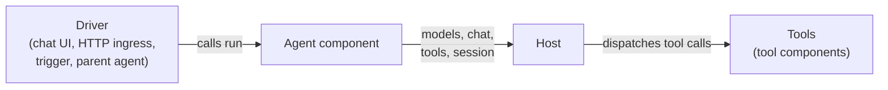

# cosmonic:agent

`cosmonic:agent` lets an agent be written once, as a WebAssembly component, and
run on any host that serves it. It holds the interfaces an agent component uses
to call models, call tools and keep a durable conversation, and the export a
host uses to hand it work. The host decides what each of those reaches, so the
agent never holds an endpoint or a credential. This page is the design note for
the package: how the pieces fit, and what a host, an agent or a tool author can
rely on. The `.wit` files are the contract;
[`world.wit`](world.wit) lists the worlds, and
[docs/migrating-to-0.4.md](docs/migrating-to-0.4.md) lists what changed from
0.3.0.

## Two sides of an agent

An agent has two interfaces, and they stay separate.

- **What it uses** (the `agent` world): `models` to get a model by a
  workload-scoped alias, `chat` to call it, `tools` to list and call tools,
  and `session` to read and append its conversation. The host serves all four
  and decides what each reaches. An agent never names an endpoint or holds a
  credential.
- **How it is driven** (`runnable-agent`, unstable feature `agent-run`): the
  agent exports `run`, and whatever drives it (a chat UI, an HTTP ingress, an
  event trigger, a parent agent) calls that. `compactable-agent` adds
  `compact`, so a driver can ask for a summary between runs.

Exporting `run` adds no power: the agent reaches exactly what its imports
allow.

## Where to go next

- **Writing an agent:** target the `agent` world, or `runnable-agent` to be
  driven through `run`. Read [Running an agent](#running-an-agent) and
  [What an agent sees](#what-an-agent-sees). To load tools or start child
  agents while it works, see [docs/spawn](docs/spawn/README.md).
- **Writing a tool:** read
  [What makes a component a tool](#what-makes-a-component-a-tool), then export
  `tools` or a typed interface of your own.
- **Implementing a host:** the `.wit` files are the contract. Read
  [Running an agent](#running-an-agent), [Session states](#session-states) and
  [Versioning](#versioning), and for the unstable discovery, loading and spawn
  interfaces, [the conformance requirements](docs/spawn/CONFORMANCE.md).

## Running an agent

`run(message, options)` is one unit of work: the person's message in, the
agent's loop of model and tool calls, a reply out.

- **Acceptance.** `run` returns once the agent has committed the message (and
  `agent.run.v1`) to the session, so a run that fails later still shows what
  was asked. A refusal (`start-error`) writes nothing.
- **Progress.** A stream of `run-event`s: text deltas, whole steps, the
  agent's current `plan` (each event replaces the last) and `compacted` when it
  summarizes its context. Then a future resolves to a `run-outcome` or a
  `run-error`.
- **Cancellation.** Dropping the event stream asks the agent to stop. It ends
  its model call and pending tool calls, records them, and resolves
  `cancelled` once nothing of the run is still running. A driver that wants
  only the outcome still reads and discards events.
- **One run at a time per session.** The driver enforces it. The agent's own
  `busy` check is a backstop against two drivers on one session.
- **Limits.** `max-steps`, `max-total-tokens` and `max-duration` (counted from
  acceptance) are enforced by the agent so it can end with a reply. A driver
  also enforces what it can meter itself, such as a deadline and byte caps.
- **The journal.** `agent.run.v1`, `agent.run-result.v1`, `agent.plan.v1`,
  `agent.compaction.v1` and the compact entries are reserved in `session`, so
  a host can redraw a conversation from the journal alone.

The host chooses the session: `run` takes no session handle, and the session
stays an import the host binds. Approvals stay at the host's own gates, so an
agent can't fake one. When nobody is there to answer, a run ends
`input-required` and the answer starts the next run.

## Tools

### What an agent sees

`tools.list` returns `tool-def`s: a name, a description, and an `input`:
a JSON Schema for the arguments (`json-schema`), text a grammar constrains
(`grammar`), or plain `text`. `tools.call` takes the model's
`tool-call` as it came, with `json` or `text` arguments, and returns a
`tool-response` with text and attachments, optional structured output, and
`is-error` for a call that ran and failed.

The agent relays what the model produced, JSON or text, so this boundary is
untyped. The agent doesn't need to know any tool's types at build time. The
host checks JSON arguments against the tool's schema; a grammar steers the
model but is not checked, so a tool validates its own text input.

Errors say what is known. `not-dispatched` means this attempt had no effect;
`outcome-unknown` means it may have. `tools.list` fails with `list-error`
rather than returning an empty list. A host may cap a tool's output and note
the original size.

### What makes a component a tool

A component becomes a tool in one of two ways.

1. **A tool provider** exports `cosmonic:agent/tools` (the `tool-provider`
   world). It lists its own definitions and parses JSON itself. An MCP bridge
   in front of an MCP server works this way.
2. **A typed tool** exports its own interface and nothing from
   `cosmonic:agent`, for example a `github` package with `pulls` and `issues`
   interfaces. A host that serves `tools` offers its functions to the agent and
   translates between JSON and the WIT types. The same component can be
   imported directly by code that wants the real types, with no JSON at all.

A typed tool is not marked as a tool in its WIT. Which components a session
offers as tools is the host's decision, from its catalog, so any component
with a suitable interface can serve, including one published by someone else.

A host translates typed tools like this:

- Every function of each exported interface outside `wasi:*` and
  `cosmonic:agent/*` becomes a tool. Its name is the function name in snake
  case (a host may present a different name to the model), and its
  description is the function's doc comment.
- A function whose only parameter is a record takes the record's fields as its
  arguments, so each field's doc comment describes one argument. Write the
  default an `option` field takes into its comment.
- JSON property names are the WIT names in snake case. `option<T>` may be
  omitted or `null`; a `bool` may be omitted and means `false`. A variant is
  `"case"`, or `{"case": payload}` with a payload; flags are a list of names.
- A `result`'s `err` is an error the model reads, not a failed call. A result
  record with a `text` field is shown as that text, with its other fields as a
  short JSON header. A field named `image`, a record of `media-type` and
  `data`, is passed to the model as an image.
- A function whose single parameter is a `string` and whose doc comment has a
  paragraph starting `Freeform:` is offered with `text` input.
- Functions that take or return resources, streams or futures have no JSON form
  and are not offered.
- Descriptions come from the tool's published WIT package, because a built
  component keeps types but not doc comments. The package's standard binary
  encoding carries them (wit-component's `package-docs`), and a host uses them
  only when the package matches the component's types exactly.

### Discovery and loading

An agent can find and add tools during a session.
Most harnesses need do nothing:
the host offers two tools of its own, `find_tools` and `load_tools`,
the model calls them,
and new tools appear in the next `tools.list`
(so list again before each model call).

A harness that manages tools in code imports `tool-discovery` and `tool-loading`
(unstable behind `agent-tool-loading`).
That covers preloading, telling offered from ready, setting aside,
and waiting until a tool is callable in the same run.
Both are one mechanism:
the host's tools are an adapter over the interfaces,
with the same catalog, approvals and function budget.

`session-tree` and `spawn` (unstable behind `agent-spawn`)
let an agent read the session tree it belongs to and its remaining budget,
and start named child agent sessions (often called subagents), possibly on other machines.
A child's reach never exceeds its ancestors'.
See [docs/spawn](docs/spawn/README.md), its [rationale](docs/spawn/RATIONALE.md)
and [conformance](docs/spawn/CONFORMANCE.md) requirements.

## Session status

`session-status` (unstable behind the `session-status` feature) names where a
session stands, so every host reports it the same way: a desktop app's session list, a cluster's session API, and
a component that drives an agent.

| State | When |
| --- | --- |
| needs input | `needs-input` is set. |
| working | `activity` is not `idle`, including an activity this version does not name. |
| failed | `last-run` ended `failed` or `interrupted`. |
| done | `last-run` ended `replied`. |
| idle | Otherwise: no run has ended since the session began or was cleared, the last run was cancelled, or it ended in a way this version does not name. |

### What sets the facts

The implementer, whatever serves the import, sets all three facts only from
what it observed itself: the run or compaction it is driving, what it holds
at its gates, and how each run it drove ended, by the outcome or error `run`
returned, a cancellation it carried out, a trap, or a stop or restart that cut
the run off. An agent can't set any of them, and a model can't either: even
the agent's own `session.clear` leaves `last-run` as it was. The run result an
agent writes to the journal is the agent's own report, so a run cut off before
`run` returned is `interrupted` even when the journal holds a result for it.

The one value the agent reports is the `finish` inside `replied`, which
arrived in the run's outcome. A caller routes on it, to tell a finished run
from one stopped at a limit or one that asked a question, and never allows
anything on it. `needs-input` comes from the implementer's gates, never from
a reply that asks a question: a run that finishes `input-required` ends
`replied`, and the person's answer starts the next run.

The activities and the run endings will grow. Until a minor release names a
new one, a host reports it as `other` with its name, and a caller treats it as
unknown. An unknown value on one fact leaves the other two readable.

A component reads the status with `get` and follows it with `watch`. It
needs only the `session-status` import, so watching a session never grants
driving it. Times are `wasi:clocks/system-clock` instants, so the import also
brings in `system-clock`, which lets the component read the wall clock. Like `session` and `run`, it never names a session:
the host binds the one it reports. It stays unstable until more
than one host adopts it, so its shape can still change, for example to let
a hold say what is held.

## Versioning

Every change to this package lands here first, as a pull request, before
hosts and agents adopt it.

- A breaking change bumps the minor version (0.4.0 to 0.5.0). Adding a case to
  a variant, a field to a record or a function to an interface a guest exports
  (`tools`, `run`) is breaking for compiled consumers.
- An additive change bumps the patch version (0.4.0 to 0.4.1) and carries
  `@since` for the new items. New interfaces, and new functions on interfaces
  the host serves, are additive.
- A variant that will grow ends in a catch-all `other` case, and its payload
  says which kind it is. A variant of states, kinds or endings carries the
  kebab-case name of the case this version does not name, as `other(string)`:
  the name is never empty, and a caller may show it but acts on nothing. An
  error variant carries diagnostic detail a caller may log and never parses.
  The released error variants carry it as `other(string)`, an empty string
  when there is none. Error variants added since carry it as
  `other(option<string>)`, and the released ones move to that shape at the
  next breaking version.
- Published artifacts never change. Interfaces that may still move are behind
  `@unstable` features (`agent-run`, `session-status`, `agent-tool-loading`
  and `agent-spawn` today).
- Versions never contain "draft".
