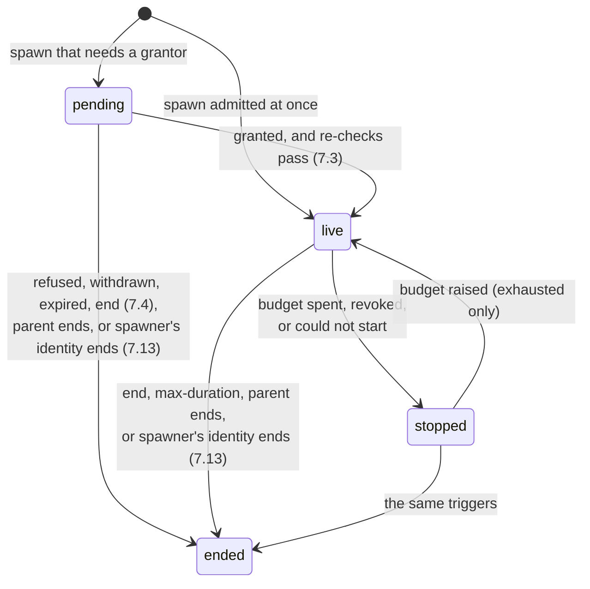
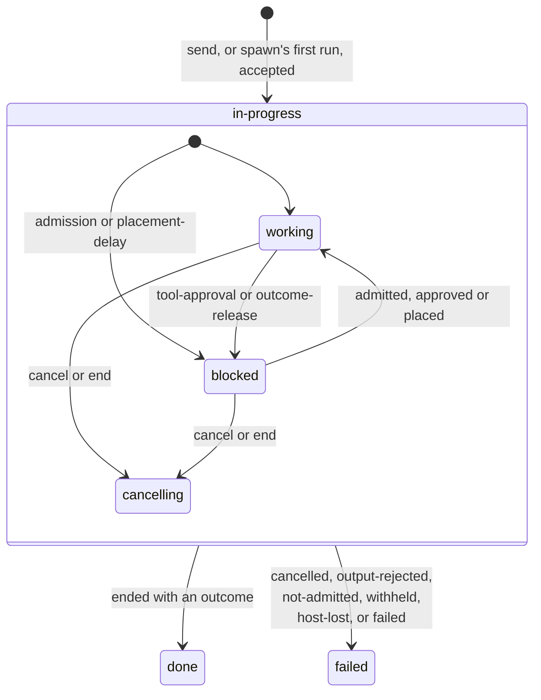

# Spawn and tool loading: conformance

What must hold for `tool-discovery`, `tool-loading`, `lineage`, `child-sessions` and `spawn`
beyond the WIT signatures.
The WIT comments say what a caller can observe and rely on;
this page says how those promises are kept.
[RATIONALE.md](RATIONALE.md) says why.
Everything is unstable.

Two parties keep these promises:

- **The host** is the layer that deploys workloads and binds sessions to them (section 2).
- **An implementer** serves one or more of the interfaces, for example as a host plugin (sections 3 to 12).

One program may be both.
"Must" is a requirement for anything that serves real agents.
A test double, or a policy layer in front of a conforming implementer,
may skip the mechanics but must not contradict what a caller observes.

## At a glance

| If you implement | Read | The hardest requirements |
| --- | --- | --- |
| The host | 1, 2 | Bind each workload to exactly one session for its whole life, put the session id in its bind configuration, and give every root a finite budget. |
| Any of the interfaces | 1, 3, 4, 12 | Read reach from the pinned binary before running anything, keep a child within its ancestors' reach plus what a grantor approved for that child (7.1, 7.6), and re-check every approval against its snapshot when it is used. |
| `tool-discovery` | 5 | Answer from the same catalog, ceiling and policy the loader admits against, and show each offer's import list. |
| `tool-loading` | 6, 10.9 | Serve the run in progress or answer `next-run`, set aside only `agent-loaded` tool components, and keep aliases fixed for the session. |
| `spawn` | 7, 8, 9, 10 | Accept a child and its first run in one atomic step, never reuse a name, stop a subtree behind a barrier, and, across machines, fence every run with a lease. |
| `child-sessions` | 11, 7.8, 7.15 | Return the same records as `spawn`, with nothing a child chose below the caller's direct children, and cap open watches. |
| `lineage` | 10.5, 11 | Report the caller's own figures exactly and its ancestors' coarsely. |

Section 13 lists the cases a conforming implementation passes.

## 1. Profiles

### 1.1 Single machine and across machines

| Requirement | Single machine | Sessions placed across machines |
| --- | --- | --- |
| Session store | Local, durable across restarts | Shared and linearizable (compare-and-swap) for leases, generations, names, approvals and limit reservations; a zone that cannot answer consistently answers `unavailable` |
| Leases and fencing | Met trivially: a run and its store share a process; a restart ends every run in progress as `host-lost` | Required (section 8) |
| Re-placement delay | Not needed | Required (8.5) |
| Brokered calls | Checked locally | A broker away from the run checks the generation with the store and fails closed |
| Placement | One machine | Operator policy (labels, zones); never a caller input |

### 1.2 Everything else applies to both

Every section not marked otherwise binds both profiles.

## 2. What the host guarantees

### 2.1 One session per workload

The host binds a workload that is offered these imports to exactly one session, for the workload's whole life.
None of the imports takes a session handle,
so this binding is what lets an implementer attribute a call to a session.

### 2.2 Session id in the bind configuration

When it creates such a workload, the host puts the session id in the workload's bind configuration,
where a host plugin can read it (3.1).

### 2.3 Stable workload incarnation

The host mints a workload incarnation when it creates the workload
and keeps it across rollouts and restarts.
Deleting or recreating the workload ends the incarnation.

### 2.4 Run context

The component that drives a session's runs passes the implementer, for each call,
the calling run's id, fencing generation, deadline and trace context.
The implementer uses them for the stopping barrier, fencing, budget checks and trace propagation.
A root session not driven through `run` takes its context from whatever drives it
(a trigger or a person's request), with its own deadline and no parent generation.

### 2.5 Policy layers

Policy layers sit in front of the implementer, installed by the host,
and pass the original caller through.
A guest component placed between a caller and the implementer would become the caller,
so there is no guest-side policy world (see [RATIONALE 4.1](RATIONALE.md#41-virtualization)).

### 2.6 Who decides

A grantor is a person, or policy a person wrote.
An auditor is installed by host policy and is never a session in the requesting tree.
A spawned agent never holds approval authority.

### 2.7 Removing an approval

Only a person removes a session ceiling entry (4.2), in the host's UI.
The UI lists every entry, bound or not.

### 2.8 Discovery adapter

In every session that has discovery,
the host offers the model-facing tools `find_tools` and `load_tools`,
so a harness that never imports the interfaces still gets them.
The names are reserved: no other tool may take them.
They are an adapter over the interfaces (6.1).

### 2.9 Every root is finite

Every root session has a token budget over its whole tree (the root's own calls included)
and an active-time budget (time during which any run in the tree is in progress).
An operator may raise them, never remove them.

## 3. Every implementer: identity and reach

### 3.1 Checking one session per workload

Serve these imports only to a workload bound to one session for its whole life,
and answer `disabled` otherwise.
On wash-runtime 2.12, a host plugin gets the caller's workload and its per-workload bind configuration:
it reads the session id from that configuration,
and answers `disabled` if there is not exactly one.

### 3.2 Attributing a call

Attribute each call by the caller's workload incarnation (2.3) and component name,
and map them to the session.

### 3.3 Reach is grants intersected with imports

Read a component's import list from the pinned binary before running anything.
Refuse (`invalid`) a component that imports a capability its baseline and grants do not cover.
The baseline is the role's world:
`agent` for an agent component, plus the imports of the powers it was given;
for a tool component, only function-less type interfaces.

### 3.4 Unused grants are dropped

A grant for an interface the component does not import is dropped
before the ceiling check and before asking anyone.
It leaves the admitted snapshot, so it is never applied.

### 3.5 Unclassified imports

An import the implementer cannot classify
(an unfamiliar interface, or a bare function import)
counts as using every kind of grant.

### 3.6 Powers a request does not give

A child component that imports a power its request does not give it is `invalid`.

### 3.7 Showing the import list

Show the import list to the grantor and in discovery offers.

### 3.8 What imports cannot show

An import list says what a component can call directly,
not where data flows through those calls (tool results, shared volumes)
or how an interface is configured.
Every agent imports `chat`, so its prompts reach its model's provider.
For a quarantined reader, use a model binding without provider-run tools or network access.

### 3.9 Fetching images

Read imports only from registries the operator allows,
with size and time caps and a pull rate per caller.
Answer every fetch failure the same way (`invalid`),
so a caller cannot probe the implementer's network position.

### 3.10 Annotations never feed reach

Tool annotations such as `read-only` are publisher claims.
They never feed reach, admission or the ceiling.

### 3.11 Credentials without a broker

An implementer without a credential broker treats every credential reference as beyond the ceiling.

### 3.12 No agent powers by grant

Refuse an `interface-grant` naming a `cosmonic:agent` interface.
Powers reach a child only through `agent-powers`, and only if the caller holds them.

### 3.13 The ceiling

A caller's ceiling is its own grants (by containment, 3.14)
plus its tool component entries (by exact match):
declared tool components, a child's spawned tool components, and the session ceiling (4.2).
An entry's reach never counts as the caller's own.

### 3.14 Containment

**Volumes.** A volume fits a caller's mount of the same storage; names are never compared.
A read-only request fits a read-only or read-write mount; a read-write request fits only a read-write one.

**Allowed hosts,** compared after normalization
(lowercase, A-labels, one trailing dot stripped, default ports dropped):

| The caller's entry | Contains |
| --- | --- |
| `*` | everything |
| A bare `h` | `h`, and `scheme://h` at the default port for `http`, `https`, `ws` and `wss` |
| `h:p` | `h:p` and `scheme://h:p` |
| `scheme://h[:p]` | only itself |
| `*.d` | hosts ending in `.d` at any depth, never `d` |

**Model aliases.** An alias fits one the caller was granted.

**Anything else.** A grant whose reach cannot be compared does not fit.

### 3.15 Location-dependent hosts

Loopback, link-local and private-range addresses, single-label names and cluster-local names
mean different services on different machines.
A child whose grants (or whose tool components' grants) name one runs on its parent's machine.
Any child runs only where its snapshot resolves identically
(the same storage, bindings and model).

### 3.16 Admitting within the ceiling

Within the ceiling, admit at once only digests in the operator's catalog or matching an entry.
Send any other digest to a grantor.

### 3.17 Tool components are dispatched, never linked

A tool component's exports are reached only through dispatch,
and its imports are served only by its own grants.
Refuse a tool component the runtime would link to a sibling
(for example a tool provider under a served-within-workload rule).

## 4. Approvals

### 4.1 Snapshot

Before asking, resolve the request into an immutable snapshot:
the storage behind each volume, the binding behind each credential,
the secret behind each name, the model behind the alias,
an agent definition's content, each interface grant's resource,
every executable digest and import list, and every default the request left open.
Show it to the grantor; never return it to the caller.
Admitting re-resolves and compares; any difference asks again.

### 4.2 Loads and the session ceiling

A load beyond the ceiling waits as `awaiting-approval`;
a later identical `load` returns that state.
A grant admits it and adds it to the **session ceiling**:
an entry keyed to the caller, the tool component and its snapshot.
A later identical load is within the ceiling,
re-checked against the snapshot and current policy each time.

### 4.3 Withdrawing a pending load

A pending load the caller sets aside is withdrawn,
as a pending child is (7.4).

### 4.4 Removal

Removing a session ceiling entry (2.7) withdraws what rests on it:
pending loads and pending children that name or rest on it,
a rollout adding it (not published; the load reports `denied`),
its binding, calls to it in flight,
and descendants' admissions that rested on it.
Withdrawal takes effect at the next dispatch as well as at the next run acceptance.

### 4.5 Races with removal

Each removal advances the session's revocation generation.
The generation only detects races:
a step that started before a removal re-checks that its own entry still exists.

### 4.6 Cooldown

After a refusal or removal, matching requests
(the same executable digests and resolved reach, whatever the names)
answer `denied` without a prompt for the cooldown.
A root's refusal covers the tree; a descendant's covers its subtree.

### 4.7 Caps on pending approvals

Pending approvals are capped per caller, per child subtree and per tree,
with one place kept for the root.
Prompts are rate-limited per subtree whatever they ask,
so varying one host cannot flood the person.

### 4.8 Grantor summaries

A summary uses catalog names, image references confirmed against the registry,
and caller-chosen names as quoted identifiers limited to `[a-z0-9-_./:]`.
Never caller free text.
A summary is shown to the requesting caller only;
below the caller's direct children, a pending state carries the approval id alone.

## 5. `tool-discovery`

### 5.1 One catalog with the loader

`list-offers` answers from the same catalog, ceiling and policy that `tool-loading` admits against,
and `find_tools` answers from `list-offers` (6.1).

### 5.2 Imports in offers

Each offer carries the import list read from its pinned binary (3.7).

## 6. `tool-loading`

### 6.1 One mechanism, two entry points

The host's `find_tools` and `load_tools` (2.8) are an adapter over `tool-discovery` and `tool-loading`.
Calling `load_tools` is `tool-loading.load` made on the agent's behalf,
with the same catalog, admission, session approval, function budget and same-run behaviour.

### 6.2 Same run where possible

Tools are dispatched, so a new tool component can be callable while the caller's instance keeps running:
roll the workload out to a revision that adds the component,
route calls to it there,
and retire the old revision when the run ends.
An implementer that cannot do this reports `next-run`.
Before publishing, check the tool component's entry or admission still stands.

### 6.3 No polling

`load` resolves at `offered`, `next-run`, `awaiting-approval` or an error,
so a caller never polls.

### 6.4 Rollout deadline

Abandon a rollout not prepared within the deadline:
the tool component becomes `failed`, frees its place,
and a waiting `load` answers `unavailable`.
A revision prepared for the next run is kept until that run starts on it.

### 6.5 Function budget

The budget comes from the model binding (`max-offered-functions`),
which the manifest may only lower,
and is the smallest among the caller's model aliases.

### 6.6 What may be set aside to make room

Set aside the least recently called tool component with origin `agent-loaded`
(never called first, then oldest).
Never set aside one with any other origin, including an unknown one,
nor one loaded or called within the residency window.

### 6.7 Unbinding

Unbind only at the component cap,
and only set-aside tool components with no call in flight.

### 6.8 Aliases

Aliases are fixed for the session and never reused for another tool component's tool.
A call to a set-aside tool component's alias answers `unknown-tool`.
Record which digest each alias denoted in the tool list sent with each model call,
and refuse a call whose alias now denotes another.

### 6.9 Results

Tool results are bounded as `tool-types.tool-response` describes.

## 7. `spawn`: children

A child moves through these states (`child-state`; `other` is for a state this version does not name):

The last run a caller started in a child moves through these (`run-state`),
with contentless progress (`run-progress`) while it is in progress:

A run held for `outcome-release` has finished its work:
it ends `done` when the outcome is released and `failed(withheld)` when it is not.
`counts` progress frames report usage at any point and change no state,
and `other` is for a state this version does not name.

### 7.1 Spawning beyond the parent's ceiling

A child's tool component beyond the parent's ceiling goes to a grantor
only if the ceiling of every ancestor above the parent covers it (none, for a root parent);
otherwise `spawn` answers `denied`.
Record that dependency for later re-checks.

### 7.2 Pending children

The child exists from the first accepted `spawn`, in `pending`, holding no instance and no reach.
Its first run waits as `blocked(admission)`, and that wait never counts as active time.
One approval admits one child:
it is a property of that session, so there is nothing to resend or consume.
`max-duration` starts at admission.

### 7.3 Admission is one atomic step

Granting a pending child re-checks, in one step:
a fresh snapshot, current policy,
the parent's and every ancestor's current ceiling,
the dependencies recorded at spawn,
limits and budgets,
and the stopping mark.
If any fails, the child is not admitted and its state says why.
A run deferred while pending is re-checked the same way before it starts.

### 7.4 Ending a pending request

| Cause | The pending child |
| --- | --- |
| A grantor refuses | ends as `ended(some(denied))` |
| The operator's approval lifetime runs out (recommended 24 hours) | ends as `ended(some(withdrawn))` |
| `end` while pending | ends as `ended(some(withdrawn))` |
| Removal of an entry, or any narrowing of an ancestor, that it rests on | is withdrawn too |

In every case the implementer frees the child's place, keeps its name, withdraws the prompt,
and fails its waiting runs with `not-admitted`.

### 7.5 A spawn's approved tool components

They become the child's own entries,
bound to that child's request (output shape, size limit, budget, powers).
They never join the parent's ceiling,
so the parent cannot load them and another child cannot use them.

### 7.6 Approvals do not extend to descendants

When a descendant's tool component matches only an entry approved for its parent's admission,
it counts as beyond the parent's ceiling, so 7.1 applies:
`denied` unless every higher ancestor covers it,
and then a grantor is asked as for the descendant's own request.
The grantor summary for a child given `spawn` says so.

### 7.7 Names are never reused

A child's name is scoped to the spawning component in its session, and a run's name to its child.
Both are `[a-z0-9-]`, 1 to 64 characters.
Match the name before any other check, so a retry of a run in progress returns that run.
Keep a record of every name used, with the request and first run (or message) it was accepted with,
for the life of the caller's session,
so a retry is always recognized and a handle can never reach a different child.

### 7.8 Retention

| What | Kept for |
| --- | --- |
| A child's run outcomes | at least the 16 most recent per child; `wait` on an older run answers `failed(expired)` |
| Ended children in listings | a retention window (recommended the 100 most recent per tree) |
| An ended child, through `get-child` by name | the session's life; `wait`, `cancel` and `end` on it are ok |

### 7.9 Joint acceptance

A child and its first run are accepted in one atomic, durable step,
including their limit reservations.
If either cannot be accepted, neither is.
A retry compares both the request and the first run; any difference is `name-taken`.

### 7.10 Powers

A child that receives `spawn` also gets `child-sessions`.
Every spawned child may import `lineage`.

### 7.11 Authority by provenance

For each of a child's grants and entries, record what it rested on:
an ancestor's grant or entry, or a grantor's approval of this child.
At each run acceptance and each child load,
re-check against that authority as it stands and against current policy.
A tool component that no longer fits is withdrawn;
a child whose own grants no longer fit is `stopped(revoked)`.

### 7.12 A child's own loads

A child's own load beyond its ceiling goes to a grantor
only if every ancestor's ceiling covers it; otherwise `denied`.

### 7.13 Lifetime

A child ends on `end`, its `max-duration`, its parent session's end,
or when the spawning component's identity ends (workload deleted or recreated).
Each of these stops the child's subtree as section 9 describes.

### 7.14 Outputs

- Validate every outcome against its output shape and `max-output-bytes`, whatever the shape.
  `output-rejected` never quotes the rejected output.
- With `structured-only`, return only the validated structured value,
  and build `finish`, `model` and counts from the implementer's own records.
  The schema is not checked for free strings.
- Copy stored attachments across the boundary and re-issue them in the receiving session;
  they count toward `max-output-bytes`.
- Enforce `max-runs` and `max-steps` by the implementer's own count, never the child's.

### 7.15 Nothing a child chose reaches the grandparent

For sessions below the caller's direct children,
return no name, no `session-status.run`, and a pending state with the approval id only.

### 7.16 Size caps

Cap instructions, schemas and messages (operator settings), answering `invalid`.

### 7.17 Handles

Keep one backing object per caller and name, recording the owning caller identity.
Every method checks it, so a handle passed to another component addresses nothing.

### 7.18 Ending through a handle

`end` consumes the handle even when it fails.
If it fails before marking the subtree, nothing changed.
Once the mark is set, ending is durable:
the implementer completes it whatever happens to the call,
and a repeated `end` (through `get-child`) is idempotent and resolves when it is done.

### 7.19 Resources served across stores

The only resource here is `spawn.child-session`, and it carries nothing but the child's name and owner:
all state is in the session store.
On a runtime where a resource served by a component host plugin is proxied into the caller's store,
a caller that crashes holding a handle leaves the plugin's side registered until the plugin restarts.
wash-runtime documents this in `crates/wash-runtime/src/engine/store/resource_bridge.rs`,
module documentation, section "Known limitations", item "Caller crash leaks reals" (wasmCloud/wasmCloud main).
An implementer should therefore keep one small plugin-side object per caller and name,
and reclaim those whose caller's workload has stopped.
A native host plugin, whose resources live in the caller's own store, has no such leak.
Durability never depends on a handle: `get-child` reaches the same child by name from any run or machine.

## 8. Runs, leases and fencing

For implementers that place sessions across machines (1.1).

### 8.1 Every run holds a lease

Root runs, runs a parent starts, and runs a person starts by talking to a child
each hold a lease with a fencing generation.
Each counts against budgets and limits and is stopped by its ancestors' `cancel`.

### 8.2 The store decides expiry

Expiry is recommended 60 seconds after the last renewal.
The generation closes when the run ends or the lease expires;
the store then rejects any write, outcome or dispatch it mediates under that generation.
Whichever machine next reads the child reports the run `host-lost`;
no particular machine has to be alive.

### 8.3 Self-fencing

The running machine stops the run's instances (agent and tool components) and cancels calls in flight
once its monotonic clock shows the store's timeout minus a margin (recommended 15 seconds)
since it *sent* its last renewal that succeeded.
A late reply does not revive a fenced run.

### 8.4 Brokered calls

Model calls, credential-brokered egress, tool dispatch and writes through a host-managed store
carry the generation.
A broker on the run's machine admits them while that machine's fence has not fired;
a broker elsewhere checks the store and fails closed.

### 8.5 Re-placement delay

After expiry, the child's next run is accepted
but starts only after a delay counted from expiry
(at least the self-fence margin, recommended 30 seconds),
shown as `blocked(placement-delay)`.
The waiting run holds its concurrency place and counts toward `max-duration`.

### 8.6 Journal completion

After a run that did not finish, once its generation is closed and before a new lease opens,
append the closing entries the run could not:
`agent.op-result.v1` with outcome `unresolved` for each tool op with no result,
then `agent.run-result.v1` with outcome `cancelled` or `failed` and why.
Nothing is replayed.

### 8.7 What fencing does not stop

Effects already under way when the fence fires,
and a machine whose clock misbehaves (a paused virtual machine),
can overlap a new run, within the child's own reach.
Direct egress through a component's own grants cannot be fenced.

## 9. Stopping

### 9.1 Barrier

`cancel`, `end` and a person's stop first mark the whole subtree as cancelling.
After the mark and until the stop completes, no run acceptance in the subtree succeeds:

| Attempt during the stop | Answer |
| --- | --- |
| `spawn` from inside the subtree | `stopping` |
| `send` from inside the subtree | `stopped` |
| `send` from outside the subtree | `busy` |
| A run a person or trigger would start | not accepted |

A store with per-key compare-and-swap meets this with one per-tree record
that every acceptance already updates for its reservation.

### 9.2 Force

Cancel cooperatively.
After the grace period (recommended 15 seconds),
stop each remaining run's instances as for self-fencing (8.3), stop metering,
and refuse that run's lease renewals, telling the renewing machine to stop.
A machine the request cannot reach is stopped by its lease.

### 9.3 Completion

`cancel` and `end` resolve when every run in the subtree has ended or lost its lease:
within the grace period plus the lease timeout.
Effects already under way are not undone.

## 10. Budgets and limits

### 10.1 Subtree charging

A session's spend counts against it and every ancestor.
When a budget is spent, runs below it finish `max-total-tokens` or `max-duration`,
and the sessions below it are `stopped(exhausted)` until an operator or person raises it.

### 10.2 A child's own `max-duration`

It is measured from admission (never while `pending`), and passing it ends the child.

### 10.3 Metering

The broker serving model calls reserves the estimated prompt plus the call's maximum output before each call,
refuses when any budget on the path cannot cover it,
and settles real usage afterwards.
A broker may instead draw down an allowance it holds locally,
as long as the sum of allowances never exceeds a budget.
A provider that reports no usage is charged the estimate.
Spend is recorded outside the run's generation, so a fenced run's spend still counts.

### 10.4 Per-run limits within the budget

The `run-options` the implementer passes when it drives a child's run stay within the child's `spawn-budget`:
a run's `max-steps` never exceeds the budget's.

### 10.5 Remaining budgets

`lineage` reports the caller's own limits exactly
and ancestors' coarsely (rounded down to a power of two tokens or a whole minute, refreshed at most once a minute).
A root's ancestor figures repeat its own, coarse.

### 10.6 `over-limit`

`over-limit` reports the configured limit, never a live count.

### 10.7 `max-spawns`

It limits spawning only.
Its default is the operator's, computed once when the request is first checked and fixed in the snapshot.

### 10.8 Reservations

Every spawn and run acceptance reserves its place atomically.

### 10.9 Defaults

| Setting | Default |
| --- | --- |
| Depth | 3 |
| Runs in progress per tree | 20 (fail fast, never queue) |
| Live children per tree | 50 |
| Children spawned per tree | 500 |
| Tool components bound per agent workload | 16 |
| Approval lifetime (pending, undecided) | 24 hours |
| `max-spawns` when unset | a quarter of what is left of the tree's total |
| Pending approvals | 3 per caller, 3 per child subtree, 5 per tree |
| Refusal cooldown | 1 hour |
| Offered functions | 32 hosted frontier models, 20 unknown, 10 local models up to about 14B parameters |
| Rollout preparation | 2 minutes, then abandoned |
| Residency before set-aside | 3 runs |
| Lease timeout, self-fence margin, re-placement delay | 60 s, 15 s, 30 s |
| Cancel grace period | 15 s |
| `watch-children` streams | 4 per caller |

## 11. `child-sessions` and `lineage`

### 11.1 Same records as `spawn`

Listings and watches return the same `session-info` records `spawn` does,
under the same rules: only children the caller's own component spawned and their descendants (7.15, 7.8).

### 11.2 Open watches

Cap open `watch-children` streams per caller (10.9);
a call over the cap answers `unavailable`.

## 12. Audit and traces

### 12.1 Audit

Record every admission (catalog, entry or grantor), refusal, removal, withdrawal,
set-aside, unbind, cancel, end and lease expiry,
each naming what it rested on.

### 12.2 Traces

Start each child run in the calling run's trace
(W3C `traceparent` only, never `tracestate` or baggage):
as a child span while the calling run is in progress, a linked span after.
Use the session id as the conversation id.

## 13. Conformance cases

Each case names the property it checks.

### 13.1 One approval, one child

Spawn a beyond-ceiling child: it is `pending`, with no instance.
Spawn the same name and request again: the same child, still one approval.
Grant it: `live`.
Spawn another name with the same request: a new approval.
Deny one: `ended(denied)`, its waiting first run fails `not-admitted`, its place is freed,
and a matching request in the cooldown answers `denied`.

### 13.2 The parent and grandchildren gain nothing

After approving a child's tool component that the root lacks,
the parent's `load` of it waits on a grantor,
a second child using it waits too,
and the child's own child using it is `denied`.

### 13.3 Admission re-checks

While a child is pending, narrow the parent's grants, remove an entry it rests on,
change policy, or start a stop:
a later grant does not admit it, and its waiting run does not start.

### 13.4 Session ceiling

Approve a load.
Set it aside and load again: `offered` with no prompt.
Have the person remove it: the next load waits on a grantor.
Remove it during its rollout: the rollout is not published.
Rebind its volume or publish a new digest: it waits again.

### 13.5 Reach from imports

A tool component that imports no HTTP or socket interface but is granted allowed hosts:
the hosts are dropped before the ceiling check.
A component importing a capability nothing grants: `invalid`.
An interface grant naming `cosmonic:agent/spawn`: `invalid`.

### 13.6 Never beyond an ancestor

A child whose agent grants exceed the parent's: `denied`.
Narrow the parent's grants: the child's next `send` answers `stopped`, and its state is `stopped(revoked)`.
Remove a parent's entry a child's tool component rested on: the child loses it.

### 13.7 Names and retries

Send run `r1`, drop the reply, send `r1` again with the same message: one run.
With another message: `name-taken`.
Drop the handle, call `get-child` from a fresh instance: the same child, and `wait` on `r1` returns its outcome.

### 13.8 State, not notices

Start runs in three children and end the caller's run.
The next run's `list-children` shows each child's `last-run` with its state.

### 13.9 Subtree stop

Cancel a child whose agent ignores cancellation:
after the grace period its instances stop, metering stops, renewals are refused, and `cancel` resolves.
During the stop, a `send` into the subtree answers `busy` and a spawn from inside answers `stopping`.

### 13.10 Lost machine

Cut off a child's machine mid-run:
within the lease timeout its `last-run` is `failed(host-lost)`;
a later write from that machine is rejected;
the next run shows `blocked(placement-delay)`;
the journal ends the interrupted run with `unresolved` op results.

### 13.11 Budgets

Spend in a grandchild counts against its parent and root.
Spend a root's tokens: runs below finish `max-total-tokens` and children are `stopped(exhausted)`.
A sibling's `get-lineage` shows only coarse ancestor figures.

### 13.12 Structured only

A child that writes text in its reply, finish reason and model name:
the caller sees only the structured value and the implementer's own fields.

### 13.13 Sessions apart

The same component in two sessions on a host that shares workloads: `disabled`.
Two sibling components: neither sees the other's children.

### 13.14 Same-run loading

`load` returns `offered` and the tool is callable in the same run,
or returns `next-run` and the tools are in the next run's `tools.list`.
A hung rollout answers `unavailable` after the deadline and the tool component shows `failed`.

### 13.15 Handles

End a child through its handle: the handle is consumed and the child ends.
Crash a caller holding handles: the children are unaffected and reachable by name.
Pass a handle to another component: it addresses nothing.

### 13.16 No child-chosen text upward

A child with `spawn` names its own runs and children with arbitrary text:
the grandparent's `list-children` with `descendants` shows no names, no `status.run`,
and pending states with ids only.

### 13.17 Disabled powers

On a host that shares workloads between sessions, every function answers `disabled`.
A plugin that finds no session id, or more than one, in the workload's bind configuration answers `disabled` too.
