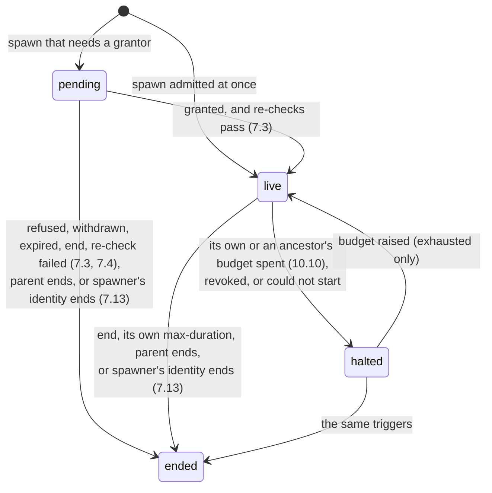
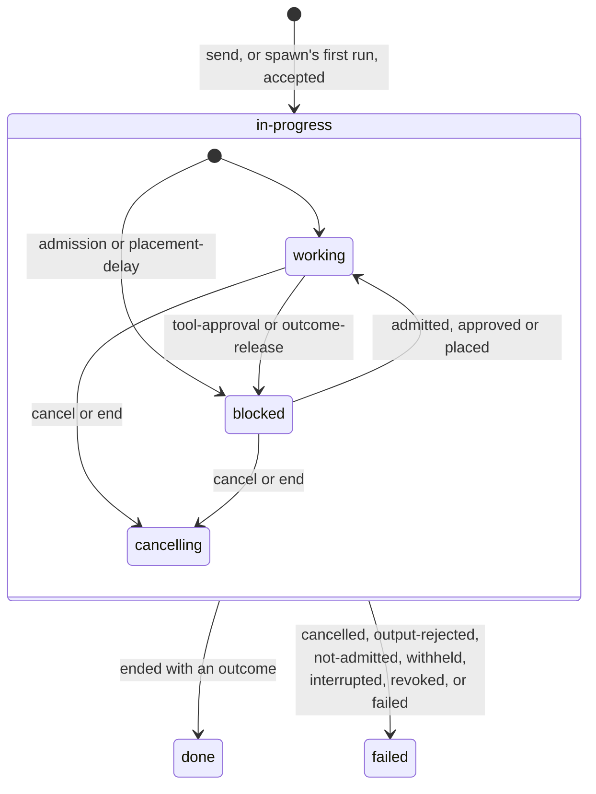

# Spawn and tool loading: conformance

What must hold for `tool-discovery`, `tool-loading`, `session-tree` and `spawn`
beyond the WIT signatures.
The WIT comments say what a caller can observe and rely on;
this page says how those promises are kept.
[RATIONALE.md](RATIONALE.md) says why.
Everything is unstable.

Two parties keep these promises:

- **The host** is the layer that deploys workloads and binds sessions to them (section 2).
- **An implementer** serves one or more of the interfaces, for example as a host plugin (sections 3 to 12).

One program may be both.
"Must" is a requirement for anything that serves real agents.
Section 14 holds notes on particular runtimes; they illustrate, and require nothing.
A test double, or a policy layer in front of a conforming implementer,
may skip the mechanics but must not contradict what a caller observes.

## At a glance

| If you implement | Read | The hardest requirements |
| --- | --- | --- |
| The host | 1, 2 | Bind each workload to exactly one session for its whole life, put the session id in its bind configuration, and give every root a finite budget. |
| Any of the interfaces | 1, 3, 4, 12 | Read reach from the pinned binary before running anything, keep a child within its ancestors' reach plus what a grantor approved for that child (7.1, 7.6), and re-check every approval against its snapshot when it is used. |
| `tool-discovery` | 5, 2.8, 3.16 | Answer from the same catalog, ceiling, policy and admission decision the loader uses, show each offer's import list, and report a failure before any offer as the call's error and one midway on the future, never as a short stream. |
| `tool-loading` | 6, 3.16, 10.9 | Serve the run in progress or answer `next-run`, follow the state table (6.10), set aside only `agent-loaded` tool components, and keep aliases fixed for the session. |
| `spawn` | 7, 8, 9, 10 | Authorize before matching a name, accept a child and its first run in one atomic step, never reuse a name, say who wrote each outcome field (7.20), withdraw narrowed authority within a bound (7.11), stop a subtree behind a barrier, and, across machines, fence every run with a lease. |
| `session-tree` | 11, 7.8, 7.15, 10.5 | List only sessions below the caller, return the same records as `spawn` with nothing a child chose below its direct children, cap open watches and end them with a reason, and report the caller's own budget figures exactly and its ancestors' coarsely. |

Section 13 lists the cases a conforming implementation passes.

## 1. Profiles

### 1.1 Single machine and across machines

| Requirement | Single machine | Sessions placed across machines |
| --- | --- | --- |
| Session store | Local, durable across restarts | Shared and linearizable (compare-and-swap) for leases, generations, names, approvals and limit reservations; a zone that cannot answer consistently answers `unavailable` |
| Leases and fencing | Met trivially: a run and its store share a process; a restart ends every run in progress as `interrupted` | Required (section 8) |
| Re-placement delay | Not needed | Required (8.5) |
| Brokered calls | Checked locally | A broker away from the run checks the generation with the store and fails closed |
| Placement | One machine | Operator policy (labels, zones); never a caller input |

### 1.2 Everything else applies to both

Every section not marked otherwise binds both profiles.

## 2. What the host guarantees

### 2.1 One session per workload

The host binds a workload that is offered these imports to exactly one session, for the workload's whole life.
None of the imports takes a session handle,
so this binding is what lets an implementer attribute a call to a session.

### 2.2 Session id in the bind configuration

When it creates such a workload, the host makes the bound session's id available to the implementer
on every call into the workload, for example in the workload's bind configuration (3.1, 14.1).

### 2.3 Stable workload incarnation

The host mints a workload incarnation when it creates the workload
and keeps it across rollouts and restarts.
Deleting or recreating the workload ends the incarnation.

### 2.4 Run context

The host or implementer records, when it accepts a run,
that run's id, fencing generation, deadline and trace context,
and attaches them to every call the run makes.
It never takes them from a guest: no component, including one that drives runs through `run-client`,
can name a run, a generation or a deadline for a call it makes.
The implementer uses them for the stopping barrier, fencing, budget checks and trace propagation.
A root session not driven through `run` takes its context from whatever drives it
(a trigger or a person's request), with its own deadline and no parent generation.

### 2.5 Policy layers

A policy layer in front of an implementer is part of it: the host installs it,
and it passes the original caller through.
A guest component placed between a caller and the implementer becomes the caller.
It then acts within its own reach and ceiling, never the original caller's,
so it cannot widen anything, but it cannot act for the caller either.
There is no guest-side policy world (see [RATIONALE 4.1](RATIONALE.md#41-virtualization)).

### 2.6 Who decides

A grantor is a person, policy a person wrote, or an auditor.
An auditor is a decision service the host installs by policy to approve or refuse requests and release outcomes.
It is never a session in the requesting tree, holds no reach of its own in that tree,
and treats every field of a request, snapshot and outcome it reads as untrusted input.
A spawned agent never holds approval authority.

### 2.7 Removing an approval

Only a person removes a session ceiling entry (4.2), in the host's UI.
The UI lists every entry, bound or not.

### 2.8 Discovery adapter

The host offers the model-facing tool `find_tools` in a session whose agent holds discovery,
and `load_tools` in one whose agent holds loading,
so a harness that never imports the interfaces still gets them.
Each exists only with its own power:
in a session without it, a call to the name answers `unknown-tool`, whoever guessed the name.
The names are reserved: no other tool may take them.
They are an adapter over the interfaces (6.1).

`find_tools` holds the cap on what the model sees, since the model chooses from one answer in one step.
For a cap of N the host sets, it reads up to N + 1 offers from the `list-offers` stream
and shows the model the first N.
If an offer arrives past the N-th, it drops the stream and tells the model that more matched
and that a narrower query shows them.
If the stream ends first, it waits on the future to tell a complete answer from a failure.
If `list-offers` fails at once, it tells the model why.
`list-offers` itself has no cap.

### 2.9 Every root is finite

Every root session has a token budget over its whole tree (the root's own calls included)
and an active-time budget (time during which any run in the tree is in progress).
An operator may raise them, never remove them.

## 3. Every implementer: identity and reach

### 3.1 Checking one session per workload

Serve these imports only to a workload bound to one session for its whole life,
and answer `disabled` otherwise,
including when the implementer cannot tell which one session a call belongs to.
Section 14.1 shows how one runtime provides this.

### 3.2 Attributing a call

Attribute each call by the caller's workload incarnation (2.3) and component name,
and map them to the session.

### 3.3 Reach is grants intersected with imports

Read a component's import list from the pinned binary before running anything.
Refuse (`invalid`) a component that imports a capability its baseline and grants do not cover.
The baseline is the role's world:
`agent` for an agent component, plus the imports of the powers it was given;
for a tool component, only function-less type interfaces.
Every other import needs a grant that covers it:

| Import | Covered by |
| --- | --- |
| `wasi:clocks`, `wasi:random`, `wasi:cli/environment`, `wasi:cli/exit`, `wasi:cli/stdout` and `stderr`, type-only interfaces such as `session-status-types` | the baseline, for every role |
| `wasi:filesystem` | a `volume-grant` |
| `wasi:http` (outgoing), `wasi:sockets` of every kind, `wasi:sockets/ip-name-lookup` | `allowed-hosts`; name lookup counts as network reach, since a query can carry data |
| `cosmonic:agent` model and tool interfaces | the agent role's world, never a grant (3.12) |
| anything else | an `interface-grant` naming exactly that interface |

### 3.4 Unused grants are dropped

A grant for an interface the component does not import is dropped
before the ceiling check and before asking anyone.
It leaves the admitted snapshot, so it is never applied.

### 3.5 Unclassified imports

An import the implementer cannot classify
(an unfamiliar interface, or a bare function import)
counts as using every kind of grant,
and is refused (`invalid`) unless an `interface-grant` names it exactly.
It is never served from the baseline.

### 3.6 Powers a request does not give

A child component that imports a power its request does not give it is `invalid`.

### 3.7 Showing the import list

Show the import list to the grantor and in discovery offers.

### 3.8 What imports cannot show

An import list says what a component can call directly,
not where data flows through those calls (tool results, shared volumes)
or how an interface is configured.
Every agent imports `chat`, so its prompts reach its model's provider.
For a quarantined reader, use a model binding without provider-run tools or network access.

### 3.9 Fetching images

Read imports only from registries the operator allows,
with size and time caps and a pull rate per caller.
Answer every fetch failure the same way (`invalid`, with the same detail text),
so a caller cannot probe the implementer's network position.

### 3.10 Annotations never feed reach

Tool annotations such as `read-only` are publisher claims.
They never feed reach, admission or the ceiling.

### 3.11 Credentials without a broker

An implementer without a credential broker treats every credential reference as beyond the ceiling.

### 3.12 No agent powers by grant

Refuse an `interface-grant` naming a `cosmonic:agent` interface.
Powers reach a child only through `spawn-request.powers` (a list of `agent-power`), and only if the caller holds them.

### 3.13 The ceiling

A caller's ceiling is its own reach (by containment, 3.14): its grants limited to what it imports (3.3, 3.4),
so a grant the caller holds but cannot use never makes a request within its ceiling.
It also includes its tool component entries (by exact match):
declared tool components, a child's spawned tool components, and the session ceiling (4.2).
An entry's reach never counts as the caller's own.
A root's ceiling is its reach the same way: an unused grant is dropped from it too.

### 3.14 Containment

**Volumes.** A volume fits a caller's mount of the same storage; names are never compared.
A read-only request fits a read-only or read-write mount; a read-write request fits only a read-write one.

**Allowed hosts,** compared after normalization
(lowercase, A-labels, one trailing dot stripped, default ports dropped):

| The caller's entry | Contains |
| --- | --- |
| `*` | everything |
| A bare `h` | `h`, and `scheme://h` at the default port for `http`, `https`, `ws` and `wss` |
| `h:p` | `h:p` and `scheme://h:p` |
| `scheme://h[:p]` | only itself |
| `*.d` | hosts ending in `.d` at any depth, never `d`; and `*.sub.d` |
| A wildcard | never an IP literal, and never a location-dependent name (3.15) |

An entry with a scheme or port contains only that scheme and port.
An IP literal contains only itself, and only where 3.15 allows it.
A case the table does not settle does not fit.

**Model aliases.** An alias fits one the caller was granted.

**Credentials.** A credential reference fits only when it resolves to the same binding the caller holds,
and the request's `allowed-hosts` are contained in the destinations that binding names.
The broker applies a credential only to requests bound for the destinations its binding names,
whatever `allowed-hosts` the component holds, so a token never goes to another host.
Without a broker, 3.11 applies.

**Secrets.** A secret fits only when it resolves to the same secret the caller holds.
A spawned agent's own component is never given secrets:
a request that names one on `agent-spec.grants` is `invalid`.
Secrets go to a tool component.

**Anything else.** A grant whose reach cannot be compared does not fit.

### 3.15 Location-dependent hosts

Loopback, link-local and private-range addresses, single-label names and cluster-local names
mean different services on different machines.
A child whose grants (or whose tool components' grants) name one runs on its parent's machine.
A wildcard never covers one: `*` or `*.internal` reaches a location-dependent address
only for a child pinned to its parent's machine,
and the implementer refuses the connection everywhere else.
Any child runs only where its snapshot resolves identically
(the same storage, bindings and model).

### 3.16 The admission decision

One decision serves `load`, `spawn` and each offer's `fit` in `tool-discovery`,
so `fit` says exactly whether a load would wait on a grantor for this caller now.
It is taken per subject: the spawned agent's own component, each tool component, and each power.

**A spawned agent's own grants** (`agent-spec.grants`) must be contained in the caller's own reach.
Anything beyond it is `denied` and never approvable,
since an approval would give an agent component direct reach (7.1).
Powers follow 7.10.

**A tool component,** whether a child's or one the caller loads, takes the first row that applies:

| The request | Decision |
| --- | --- |
| Policy refuses it | `denied` |
| Reaches beyond what some ancestor above the caller covers, in its ceiling or in an approval already granted to it (7.12) | `denied` |
| Policy asks for a grantor | wait on a grantor |
| Within the caller's ceiling, and every digest is in the operator's catalog as an entry this caller would be offered, or matches a ceiling entry exactly (3.13) | admit, no grantor |
| Within the caller's ceiling, with any other digest | wait on a grantor |
| Beyond the caller's ceiling | wait on a grantor |

"Some ancestor above the caller" excludes the caller itself:
going beyond the caller's own ceiling is what a grantor decides.
A catalog entry hidden from this caller by policy counts as any other digest,
so naming its digest in a `custom` spec gains nothing a discovery answer would not.
An entry matched exactly is re-checked against its snapshot and current policy each time (4.2).

### 3.17 Tool components are dispatched, never linked

A tool component's exports are reached only through dispatch,
and its imports are served only by its own grants.
Refuse a tool component the runtime would link to a sibling
(for example a tool provider under a served-within-workload rule).

### 3.18 Diagnostics

Detail strings returned to a caller are the implementer's own words, bounded (10.9), and safe for that caller to read.
Never put in them text a child or a tool wrote, secret or credential values,
names of bindings or storage the caller was not shown,
or addresses of the implementer's infrastructure.
Answer failures a caller must not tell apart with the same case and the same text.
These pairs must look alike:

| Must look alike | Answer |
| --- | --- |
| An image fetch that failed, whatever the reason (3.9) | `invalid`, one text |
| An unknown catalog name, and one policy hides from this caller | `invalid`, one text |
| An unknown model alias, volume, secret or credential reference, and one that exists but the caller does not hold | `invalid`, one text |

Keep the full detail in the implementer's own logs.

## 4. Approvals

### 4.1 Snapshot

Before asking, resolve the request into an immutable snapshot:
the storage behind each volume, the binding behind each credential,
the secret behind each name, the model behind the alias,
an agent definition's content, each interface grant's resource,
every executable digest and import list, and every default the request left open.
Show it to the grantor; never return it to the caller.
Show resolved resources (the storage, the binding, the registry digest), not the caller's strings for them.
Every caller-supplied string that does reach the grantor
(a component name, a mount path, an interface grant's config values, a display image reference)
is shown quoted, marked as chosen by the caller, and held to 4.8's character set and length.
Admitting re-resolves and compares; any difference asks again.

### 4.2 Loads and the session ceiling

A load beyond the ceiling waits as `awaiting-approval`;
a later identical `load` returns that state.
Two loads are identical when they name the same executable digests, resolve to the same reach,
and offer the same function set: `functions` compared as a set, with `none` meaning every function.
The snapshot records the function set and the grantor sees it.
A load that offers more functions than an entry is not identical to it and asks again;
one that offers fewer fits the entry.
A grant admits it and adds it to the **session ceiling**:
an entry keyed to the caller, the tool component and its snapshot.
A later identical load is within the ceiling,
re-checked against the snapshot and current policy each time.

### 4.3 Withdrawing a pending load

A pending load the caller sets aside is withdrawn, as a pending child is (7.4),
and leaves the listing.

### 4.4 Removal

Removing a session ceiling entry (2.7) withdraws what rests on it:
pending loads and pending children that name or rest on it,
a rollout adding it (not published; the load reports `denied`),
its binding, calls to it in flight,
and descendants' admissions that rested on it.
Withdrawal follows 7.11: it takes effect within the revocation bound,
and before any later dispatch or run acceptance.

### 4.5 Races with removal

Each removal advances the session's revocation generation.
The generation only detects races:
a step that started before a removal re-checks that its own entry still exists.

### 4.6 Cooldown

After a refusal or removal, matching requests
(the same executable digests and resolved reach, whatever the names)
answer `denied` without a prompt for the cooldown.
A root's refusal covers the tree; a descendant's covers its subtree.
`denied` because a request reaches beyond an ancestor (3.16) counts toward the same rate limit as prompts,
and is audited,
so a child cannot cheaply map which hosts or volumes its ancestors hold.
A cooldown a descendant meets says only `denied`, never whose refusal it was.

### 4.7 Caps on pending approvals

Pending approvals are capped per caller, per child subtree and per tree,
with one place kept for the root.
Prompts are rate-limited per subtree whatever they ask,
so varying one host cannot flood the person.

### 4.8 Grantor summaries

A summary uses catalog names, image references confirmed against the registry,
and caller-chosen names as quoted identifiers limited to `[a-z0-9-_./:]` and 64 characters,
each marked as the caller's choice.
Never caller free text.
A caller-chosen name never reads as the implementer's own words or as a verdict.
A summary is shown to the requesting caller only;
below the caller's direct children, a pending state carries the approval id alone.

## 5. `tool-discovery`

### 5.1 One catalog with the loader

`list-offers` answers from the same catalog, ceiling and policy that `tool-loading` admits against,
and `find_tools` answers from `list-offers` (6.1).

### 5.2 Imports in offers

Each offer carries the import list read from its pinned binary (3.7).

### 5.3 Streaming offers

Send offers best match first, with no cap of the implementer's own,
and produce them lazily where the catalog allows,
so a large or remote catalog costs only what the caller reads.
When the caller drops the stream, stop producing offers and resolve the future `ok`.
Resolve the future only after the stream has ended or been dropped.

Never report a failure as a stream that silently ends short:

| Discovery fails | The caller sees |
| --- | --- |
| Before any offer (for example `disabled` or `denied`) | The call's own error. No stream is returned. |
| Midway | The stream ends after the offers already sent, then the future resolves to the error. Those offers stay valid, but they are not all the matches. |

A stream that ends with the future resolving `ok` carried every match.

Cap open `list-offers` streams per caller (10.9); a call over the cap fails at once with `unavailable`.

## 6. `tool-loading`

### 6.1 One mechanism, two entry points

The `find_tools` and `load_tools` tools (2.8) are an adapter over `tool-discovery` and `tool-loading`,
each offered only where its power is held.
Calling `find_tools` is `list-offers` read up to the adapter's cap, plus one offer to tell whether more matched (2.8).
Calling `load_tools` is `tool-loading.load` made on the agent's behalf,
with the same authorization, catalog, admission decision (3.16), session approval, function budget and same-run behaviour.
Neither adapter can do what its interface would refuse the same caller.

### 6.2 Same run where possible

Tools are dispatched, so a new tool component can be callable while the caller's instance keeps running:
roll the workload out to a revision that adds the component,
route calls to it there,
and retire the old revision when the run ends.
An implementer that cannot do this reports `next-run`.
Before publishing, check the tool component's entry or admission still stands.

### 6.3 No blocking on a person

`load` resolves at `offered`, `next-run`, `awaiting-approval` or an error,
so a call never blocks on a person.
Nothing signals the caller when a grantor decides.
A caller learns the decision by calling `load` again or reading `list-loaded`, typically in a later run;
a repeat `load` of a request that is still waiting returns `awaiting-approval` at once.

### 6.4 Rollout deadline

Abandon a rollout not prepared within the deadline:
the tool component becomes `failed`, frees its place,
and a waiting `load` answers `unavailable`.
A revision prepared for the next run is kept until that run starts on it.
Rollouts are rate-limited per session, so a caller cycling `load` and `set-aside` at the component cap
cannot churn revisions without bound; past the rate, `load` answers `unavailable`.

### 6.5 Function budget

The budget comes from the model binding (`max-offered-functions`),
which the manifest may only lower,
and is the smallest among the caller's model aliases.

### 6.6 What may be set aside to make room

Set aside the least recently called tool component with origin `agent-loaded`
(never called first, then oldest).
Never set aside one with any other origin, including an unknown one,
nor one loaded or called within the residency window.

### 6.7 Unbinding

Unbind only at the component cap,
and only set-aside tool components with no call in flight.
An unbound tool component stays `set-aside` with its approval;
loading it again goes through `loading` without asking a grantor.

### 6.8 Aliases

Aliases are fixed for the session and never reused for another tool component's tool.
A call to a set-aside tool component's alias answers `unknown-tool`.
Record which digest each alias denoted in the tool list sent with each model call,
and refuse a call whose alias now denotes another.

### 6.9 Results

Tool results are bounded as `tool-types.tool-response` describes.

### 6.10 States

A tool component moves through `tool-component-state` as follows.
Approval, binding and availability in the current run are separate:
a set-aside tool component keeps its approval whether or not it is bound,
and one that could serve only the next run keeps that restriction while set aside.

| From | Event | To |
| --- | --- | --- |
| (not held) | `load` that waits on a grantor (3.16) | `awaiting-approval` |
| (not held) | `load` admitted at once | `loading` |
| `awaiting-approval` | granted, and the re-checks pass | `loading` |
| `awaiting-approval` | refused, or expired undecided | `denied` |
| `awaiting-approval` | `set-aside` (withdrawn) | not held |
| `loading` | ready, and the run in progress can call it | `offered` |
| `loading` | ready, and only the next run can call it | `next-run` |
| `loading` | rollout failed or out of time (6.4) | `failed` |
| `next-run` | the caller's next run starts | `offered` |
| `offered` or `next-run` | `set-aside`, or set aside to make room (6.6) | `set-aside` |
| `set-aside` | `load`, still bound, the run in progress can call it | `offered` |
| `set-aside` | `load`, still bound, it was `next-run` and that run has not started | `next-run` |
| `set-aside` | `load`, unbound meanwhile (6.7) | `loading` |
| `denied` or `failed` | `load` | as a new load (a refusal's cooldown still applies) |
| `denied` or `failed` | `set-aside` | not held |
| `denied` | the cooldown ends | stays `denied` until `load` or `set-aside` |
| any | the person removes its entry (2.7, 4.4) | not held; a later `load` asks again |
| any | it no longer fits its ancestors' current reach or policy (7.11) | not held, within the revocation bound; a later `load` is decided again |

`set-aside` on a `loading` tool component answers `loading`;
on one already `set-aside` it does nothing.

## 7. `spawn`: children

A child moves through these states (`child-state`; `other` is for a state this version does not name):

In `live`, report the child's status as the implementer reports it under `session-status`,
with no `finish` text the child chose (7.14) and no run ids below the caller's direct children (7.15).

The last run a caller started in a child moves through these (`run-state`, in `session-info.sent-run`),
with contentless progress (`run-progress`) while it is in progress:

`expired` is not an ending: a run stays `done` or `failed` as it ended,
and `expired` is what `wait` and `watch-run` answer once its outcome is no longer kept (7.8).

A run held for `outcome-release` has finished its work:
it ends `done` when the outcome is released and `failed(withheld)` when it is not.
Each run records one terminal transition, and the first the store records wins (7.23).
`counts` progress frames report usage at any point and change no state,
and `other` is for a state this version does not name.

### 7.1 Spawning beyond the parent's ceiling

A child's own agent component gets reach only from its parent:
`agent-spec.grants` must be contained in the parent's reach (3.13, 3.14).
Anything beyond is `denied`, and never goes to a grantor,
so an approval can never give an agent component direct reach.
Reach the parent lacks goes in a tool component.

A child's tool component beyond the parent's ceiling goes to a grantor
only if every ancestor above the parent covers it, in its ceiling or in an approval already granted to it
(no ancestor needs to, for a root parent);
otherwise `spawn` answers `denied`.
Record that dependency for later re-checks.

### 7.2 Pending children

The child exists from the first accepted `spawn`, in `pending`, holding no instance and no reach.
Its first run waits as `blocked(admission)`, and that wait never counts as active time.
One approval admits one child:
it is a property of that session, so there is nothing to resend or consume.
`max-duration` starts at admission.

### 7.3 Admission is one atomic step

Granting a pending child re-checks, in one step:
a fresh snapshot, current policy,
the parent's and every ancestor's current ceiling,
the dependencies recorded at spawn,
limits and budgets,
and the stopping mark.
If any fails, the child is not admitted: it ends as `ended(some(revoked))`, with the failed check in the detail,
its place is freed, and its waiting runs fail `not-admitted`.
A run deferred while pending is re-checked the same way before it starts.

### 7.4 Ending a pending request

| Cause | The pending child |
| --- | --- |
| A grantor refuses | ends as `ended(some(denied))` |
| The operator's approval lifetime runs out (recommended 24 hours) | ends as `ended(some(withdrawn))` |
| `end` while pending | ends as `ended(some(withdrawn))`; its waiting runs fail `cancelled` |
| Removal of an entry, or any narrowing of an ancestor, that it rests on | ends as `ended(some(revoked))` |

In every case the implementer frees the child's place, keeps its name and withdraws the prompt.
Its waiting runs fail `not-admitted`, except after `end`, where they fail `cancelled`
because the caller stopped them.

### 7.5 A spawn's approved tool components

They become the child's own entries,
bound to that child's request (output shape, size limit, budget, powers).
They never join the parent's ceiling,
so the parent cannot load them and another child cannot use them.

### 7.6 Approvals do not extend to descendants

When a descendant's tool component matches only an entry approved for its parent's admission,
it counts as beyond the parent's ceiling, so 7.1 applies:
`denied` unless every higher ancestor covers it,
and then a grantor is asked as for the descendant's own request.
The grantor summary for a child given `spawn` says so.

### 7.7 Names are never reused

A child's name is scoped to the spawning component in its session, and a run's id to its child.
Both are `[a-z0-9-]`, 1 to 64 characters.

Authorize first: the caller's identity, that it holds `spawn` now, and that the handle is its own (7.17).
Then match the name before any other check, so a retry of a run in progress returns that run,
and only then check the barrier, limits and reservations for something new.
A retry that matches makes no new reservation and never restores access that was withdrawn:
it returns the child or run as it now stands.

A retry is identical when the request and first run (or message) are the same values as the caller sent them,
compared field by field before resolving catalog entries or defaults:
strings, including JSON schemas and structured values, byte for byte;
lists in order; attachments by the ids the caller sent (7.22).
Keep a record of every name used, with what it was accepted with,
for the life of the caller's session,
so a retry is always recognized and a handle can never reach a different child.

The caller's run id is the `run-id` the child's run is driven under,
so the child's `session-status` shows it to a direct parent.
A run started any other way (by a person, a trigger) keeps the id its driver gave it,
which may itself be in `[a-z0-9-]`, such as a UUID.
In every status this interface returns, show such an id under a prefix the implementer reserves,
containing a character outside `[a-z0-9-]` (for example `ext:`),
so it never collides with an id the caller chose.

### 7.8 Retention

| What | Kept for |
| --- | --- |
| A child's run outcomes | at least the 16 most recent per child; `wait` on an older run answers `failed(expired)` |
| Ended children in listings | a retention window (recommended the 100 most recent per tree) |
| An ended child, through `get-child` by name | the session's life; `wait`, `cancel` and `end` on it are ok |

### 7.9 Joint acceptance

A child and its first run are accepted in one atomic, durable step,
including their limit reservations.
If either cannot be accepted, neither is.
A retry compares both the request and the first run; any difference is `name-taken`.

### 7.10 Powers

Every spawned child may import `session-tree`, whatever powers it was given.
It reads only the child's own place and the sessions below it (11.1),
so a child without `spawn` lists no sessions.

### 7.11 Authority by provenance, and revocation

For each of a child's grants, entries and powers, record what it rested on:
an ancestor's grant or entry, or a grantor's approval of this child.
At each run acceptance and each child load,
re-check against that authority as it stands and against current policy.

Narrowing does not wait for the next check.
When an authority a child rests on narrows
(a grant or entry removed, a power withdrawn, policy changed),
then within the revocation bound (10.9),
and before the implementer mediates any later dispatch, model call or brokered egress that relies on it:

- withdraw an affected tool component (its calls in flight are cancelled);
- for a child whose own grants or powers no longer fit,
  stop its run's instances as 9.2 describes, end that run `failed(revoked)`,
  and mark the child `halted(revoked)`;
- do the same for every descendant whose recorded authority rests on the change;
- when the spawner itself loses `spawn`, treat every child it spawned as resting on that power:
  withdraw its pending children (`ended(some(revoked))`),
  and stop the rest of its subtree behind the barrier (9.1) as `halted(revoked)`,
  since the spawner can no longer `cancel` or `end` them.

Reach already applied to a running instance cannot be narrowed in place, so the instance is stopped.
Direct egress through a component's own grants between the change and the stop is the limit of this guarantee (8.7).

### 7.12 A child's own loads

A child's own load beyond its ceiling goes to a grantor
only if every ancestor above it covers it, in its ceiling or in an approval already granted to it;
otherwise `denied` (3.16).

### 7.13 Lifetime

A child ends on `end`, its `max-duration`, its parent session's end,
or when the spawning component's identity ends (workload deleted or recreated).
Each of these stops the child's subtree as section 9 describes.
A child that ended because its parent ended, or its spawner's identity ended,
reports `ended(some(parent-ended))`, and so does every descendant it takes with it.
A child's existence also rests on its spawner holding `spawn` (7.11).

### 7.14 Outputs

- Fill each outcome field from the source 7.20 gives it, under every output shape.
- Check every outcome as 7.21 describes, whatever the shape.
- Move attachments across the boundary as 7.22 describes.
- Enforce `max-runs` and `max-steps-per-run` by the implementer's own count, never the child's.
- In every `live` status, at any depth, a `finish` the child reported as `other` carries an empty string,
  and with `structured-only` the `finish` in `last-run` comes from the implementer's own records, as in the outcome.

### 7.15 No text a child chose reaches the grandparent

In every record `session-tree` or `spawn` returns for a session below the caller's direct children,
return no name, a pending state with the approval id only,
and a `live` status whose run ids (`activity.running`, `last-run.run`) are `none`.
Below direct children, also coarsen what a descendant could use to signal upward:
instants rounded down to a whole minute,
usage rounded down to a power of two tokens and runs,
and a `finish` in `last-run` replaced by the implementer's own, as `structured-only` does (7.20).
A descendant can still signal through how much it spends and when, at that coarser grain;
`spawn-types` states the channel.

### 7.16 Size caps

Cap instructions, schemas and messages (operator settings), answering `invalid`.
Cap open `child-run` subscriptions per caller (10.9);
past the cap, `send` and `watch-run` answer `unavailable` without opening another.
A `send` refused this way starts no run, so a retry once a subscription closes starts it once.

### 7.17 Handles

Keep one backing object per caller and name, recording the owning caller identity.
Every method checks it before anything else,
so a handle passed to another component acts on nothing:

| Method, called by another component | Answer |
| --- | --- |
| `get-name` | the name, which authorizes nothing |
| `get-info`, `cancel` | `not-owner` |
| `send` | `not-owner` |
| `watch-run`, `wait` | `not-owner` |
| `end` | `not-owner`; the handle is consumed and the child is untouched |

### 7.18 Ending through a handle

`end` consumes the handle even when it fails.
If it fails before marking the subtree, nothing changed.
Once the mark is set, ending is durable:
the implementer completes it whatever happens to the call,
and a repeated `end` (through `get-child`) is idempotent and resolves when it is done.

### 7.19 Resources served across stores

The only resource here is `spawn.child-session`, and it carries nothing but the child's name and owner:
all state is in the session store.
Where a runtime keeps an implementer-side object for each handle a caller holds,
a caller that crashes may leave that object behind (14.2).
Keep it small, one per caller and name,
and reclaim those whose caller's workload has stopped.
Durability never depends on a handle: `get-child` reaches the same child by name from any run or machine.

### 7.20 Who wrote each outcome field

| Field | `reply` | `reply-and-structured` | `structured-only` |
| --- | --- | --- | --- |
| `reply` | the child's | the child's | withheld: empty |
| `structured` | `none` | the child's, validated against the schema | the child's, validated against the schema |
| `finish` | the child's report | the child's report | the implementer's: a limit it enforced, `refusal` or `content-filter` as the provider answered, otherwise `done` |
| `counts` | the implementer's metering | the same | the same |
| `model` | the implementer's record of the model that served the last call | the same | the same |

A field the child wrote is untrusted content: it can carry anything the child read,
and it authorizes nothing, even when it matches its schema.
A caller routes on a reported `finish` and never allows anything on it.

### 7.21 Checking outputs

- Validate every outcome against its output shape and `max-output-bytes`.
  `output-rejected` never quotes the rejected output.
- Schemas are JSON Schema 2020-12.
  Refuse at `spawn` (`invalid`) a schema that uses a keyword the implementer does not enforce,
  or refers outside itself.
  Validation is bounded (10.9); a schema whose cost the implementer cannot bound,
  such as a `pattern` it cannot run in linear time, is `invalid`.
  The schema is not checked for free strings: a schema with a string field passes child text through.
- A run whose last model call the provider answered with a refusal or a safety filter
  finishes `refusal` or `content-filter` with `structured` none, under every shape.
  It is not `output-rejected`.
  Under `structured-only` its reply stays withheld; the size limit still applies.
  Any other outcome without a valid structured value under a structured shape is `output-rejected`.
- The encoded size of an outcome is the sum of the UTF-8 byte lengths of every string in it as delivered
  (reply parts, the structured value's JSON text, a `finish` carrying `other` text)
  plus the length of each attachment's content.
  Count it after the output shape is applied and before attachment ids are reissued.

### 7.22 Attachments in both directions

- **From child to caller.** Copy stored attachments across the boundary and reissue them in the caller's session;
  they count toward `max-output-bytes` (7.21).
  A URL attachment in a child's outcome is never passed on as a URL,
  since the caller's model call would fetch it under the caller's egress:
  fetch it under the child's own reach, and reissue its content as a stored attachment,
  or, if the child's reach does not cover it, reject the outcome (`output-rejected`).
  Drop `opaque` reply parts, which no check can read,
  and pass citations as text only, never as a URL anything fetches on the caller's behalf.
- **From caller to child**, in a first run or `send`, at acceptance:
  check that each stored attachment id belongs to the caller's session (`invalid` otherwise),
  copy it into the child's session under a new id, and count it toward the message size cap (7.16).
  Fetch a URL attachment then, under the caller's reach, and pass its content;
  the child never gains egress for it.
  Keep the copies while the run waits (for admission or placement).
- A retry compares the attachment ids the caller sent, never the copies.

### 7.23 Cancelling at every phase

`cancel` and `end` set the cancelling mark first (9.1).
From then on the stop is durable: it completes even if the call that started it is dropped.
Each run records one terminal transition, and the first the store records wins:
an outcome released before the mark ends `done`; after it, the run ends `failed(cancelled)`.

| The run is | On `cancel` or `end` |
| --- | --- |
| waiting for admission (`blocked(admission)`) | fails `cancelled`; the child stays `pending` on `cancel` and ends on `end` |
| waiting for placement (`blocked(placement-delay)`) | fails `cancelled` and is never placed |
| working | cancelled cooperatively, then by force (9.2); fails `cancelled` |
| waiting on a tool approval (`blocked(tool-approval)`) | the held request is withdrawn; fails `cancelled` |
| holding its outcome for release (`blocked(outcome-release)`) | the release request is withdrawn and the outcome discarded; fails `cancelled` |

### 7.24 How the endings relate

The caller's view of a run it sent (`run-state`) and the child's own last run (`session-status.run-end`)
describe the same run from two sides.
Report them consistently:

| `run-state` | The child's `last-run` |
| --- | --- |
| `done` | `replied`, with the child's `finish` |
| `failed(cancelled)` | `cancelled` |
| `failed(output-rejected)` or `failed(withheld)` | `replied`: the child finished; the caller's check or a release decision kept the outcome back |
| `failed(cancelled)` while holding its outcome for release | `replied`: `run` had already returned |
| `failed(interrupted)` or `failed(revoked)` | `interrupted`: the implementer cut the run off before `run` returned its outcome, even if the journal holds a result the agent wrote |
| `failed(failed)` | `failed`: the agent returned a `run-error` (its own `output-rejected` included) or trapped |
| `failed(not-admitted)` | unchanged: the run never started |
| `failed(expired)`, as `wait` answers | not an ending: the outcome aged out after the run ended as the other rows say |

## 8. Runs, leases and fencing

For implementers that place sessions across machines (1.1).

### 8.1 Every run holds a lease

Root runs, runs a parent starts, and runs a person starts by talking to a child
each hold a lease with a fencing generation.
Each counts against budgets and limits and is stopped by its ancestors' `cancel`.

### 8.2 The store decides expiry

Expiry is recommended 60 seconds after the last renewal.
The generation closes when the run ends or the lease expires;
the store then rejects any write, outcome or dispatch it mediates under that generation.
Whichever machine next reads the child reports the run `interrupted`;
no particular machine has to be alive.

### 8.3 Self-fencing

The running machine stops the run's instances (agent and tool components) and cancels calls in flight
once its monotonic clock shows the store's timeout minus a margin (recommended 15 seconds)
since it *sent* its last renewal that succeeded.
A late reply does not revive a fenced run.

### 8.4 Brokered calls

Model calls, credential-brokered egress, tool dispatch and writes through a host-managed store
carry the generation.
A broker on the run's machine admits them while that machine's fence has not fired;
a broker elsewhere checks the store and fails closed.

### 8.5 Re-placement delay

After expiry, the child's next run is accepted
but starts only after a delay counted from expiry
(at least the self-fence margin, recommended 30 seconds),
shown as `blocked(placement-delay)`.
The waiting run holds its concurrency place and counts toward `max-duration`.

### 8.6 Journal completion

After a run that did not finish, once its generation is closed and before a new lease opens,
append the closing entries the run could not:
`agent.op-result.v1` with outcome `unresolved` for each tool op with no result,
then `agent.run-result.v1` with outcome `cancelled` or `failed` and why.
Nothing is replayed.
The child's `live` status keeps reporting that run's `last-run` as `interrupted`,
since these entries are the implementer's, not the run's own result.

### 8.7 What fencing does not stop

Effects already under way when the fence fires,
and a machine whose clock misbehaves (a paused virtual machine),
can overlap a new run, within the child's own reach.
Direct egress through a component's own grants cannot be fenced.

## 9. Stopping

### 9.1 Barrier

`cancel`, `end` and a person's stop first mark the whole subtree as cancelling.
After the mark and until the stop completes, no run acceptance in the subtree succeeds:

| Attempt during the stop | Answer |
| --- | --- |
| `spawn` from inside the subtree | `stopping` |
| `send` into the subtree, from inside or outside it | `stopping` |
| A run a person or trigger would start | not accepted |

A store with per-key compare-and-swap meets this with one per-tree record
that every acceptance already updates for its reservation.

### 9.2 Force

Cancel cooperatively.
After the grace period (recommended 15 seconds),
stop each remaining run's instances as for self-fencing (8.3), stop metering,
and refuse that run's lease renewals, telling the renewing machine to stop.
A machine the request cannot reach is stopped by its lease.

### 9.3 Completion

`cancel` and `end` resolve when every run in the subtree has ended or lost its lease:
within the grace period plus the lease timeout.
Effects already under way are not undone.

## 10. Budgets and limits

### 10.1 Subtree charging

A session's spend counts against it and every ancestor.
When a token budget or a root's active-time budget is spent,
the broker refuses every further model call below it.
A run in progress there ends however its agent handles that refusal, usually `failed`:
the implementer never writes a `finish` for the agent.
The sessions below it are `halted(exhausted)` until an operator or person raises the budget.

### 10.2 A child's own `max-duration`

It is a lifetime, not a budget.
It is measured from admission (never while `pending`),
and passing it ends the child as `ended(some(exhausted(max-duration)))`.
Its descendants end with it, as when any parent ends, and report `ended(some(parent-ended))`.
When an ancestor's budget is spent at the same time, ending wins over halting.

### 10.3 Metering

Token budgets bound accounted usage, and the accounting never undercounts.
Before each model call, the broker serving it reserves the prompt as the implementer counts it
plus the call's maximum output, which the implementer sets on the call whatever the guest asked.
It refuses the call when any budget on the path cannot cover the reservation,
and settles real usage afterwards.
A call whose output it cannot bound is refused.
A provider that reports no usage is charged the full reservation.
A broker may instead draw down an allowance it holds locally,
as long as the sum of allowances never exceeds a budget.
Spend is recorded outside the run's generation, so a fenced run's spend still counts.

### 10.4 Per-run limits within the budget

The `run-options` the implementer passes when it drives a child's run stay within the child's `spawn-budget`:
a run's `max-steps` never exceeds `max-steps-per-run`.

### 10.5 Remaining budgets

`session-tree.get-lineage` reports the caller's own limits exactly
and ancestors' coarsely (rounded down to a power of two tokens or a whole minute, refreshed at most once a minute).
A root's ancestor figures repeat its own, coarse.
Coarse figures narrow what a subtree learns of its siblings' spending without closing it:
a change in an ancestor's figure still says that something below that ancestor spent.

### 10.6 `over-limit`

`over-limit` reports the configured limit, never a live count.

### 10.7 `max-spawns`

It limits spawning only.
Its default is the operator's, computed once when the request is first checked and fixed in the snapshot.

### 10.8 Reservations

Every spawn and run acceptance reserves its place atomically.

### 10.9 Defaults

| Setting | Default |
| --- | --- |
| Depth | 3 |
| Runs in progress per tree | 20 (fail fast, never queue) |
| Live children per tree | 50 |
| Children spawned per tree | 500 |
| Tool components bound per agent workload | 16 |
| Approval lifetime (pending, undecided) | 24 hours |
| `max-spawns` when unset | a quarter of what is left of the tree's total |
| Pending approvals | 3 per caller, 3 per child subtree, 5 per tree |
| Refusal cooldown | 1 hour |
| Offered functions | 32 hosted frontier models, 20 unknown, 10 local models up to about 14B parameters |
| Rollout preparation | 2 minutes, then abandoned |
| Residency before set-aside | 3 runs |
| Lease timeout, self-fence margin, re-placement delay | 60 s, 15 s, 30 s |
| Cancel grace period | 15 s |
| Revocation bound (7.11) | 60 s |
| Detail strings returned to a caller (3.18) | 256 bytes |
| `watch-children` streams | 4 per caller |
| `session-status` watches | 4 per caller |
| Open `list-offers` streams | 4 per caller |
| Open `child-run` subscriptions | 16 per caller |
| Instructions, schema, message (7.16) | 64 KiB, 64 KiB, 256 KiB |
| `max-output-bytes` when unset | 256 KiB |
| Image size, pull time, pulls (3.9) | 256 MiB, 2 minutes, 10 per minute per caller |
| Grantor prompts (4.7) | 5 per hour per child subtree |
| Rollouts (6.4) | 10 per hour per session |
| Schema validation (7.21) | 100 ms of work per outcome |
| A child's `max-runs` and `max-duration` when unset | 100 runs; 24 hours |
| A child subtree's `max-concurrent-runs` and `max-live-children` when unset (10.11) | half of the tree's |

### 10.10 `max-runs`

It counts runs accepted in the child's own session, whoever starts them (its parent, a person, a trigger).
A retry that returns an existing run counts nothing.
A descendant's runs count under its own `max-runs`;
runs in progress are bounded per child subtree and across the tree (10.11).

When a session's own `max-runs` or `max-total-tokens` is spent,
it becomes `halted(exhausted(max-runs))` or `halted(exhausted(max-total-tokens))`,
and `send` to it answers `halted` until its budget is raised.

### 10.11 Shares of tree-wide limits

Runs in progress and live children are limited across the tree (10.9),
so one subtree could otherwise take every place.
Each child's `spawn-budget` carries `max-concurrent-runs` and `max-live-children` for its subtree;
unset, each defaults to half of what the tree allows.
Every tree-wide limit keeps one place for the root's own runs and children.
Retention of ended children in listings (7.8) is counted per caller, not per tree.

## 11. `session-tree`

### 11.1 Only below the caller

`list-children` and `watch-children` cover only children the caller's own component spawned
and their descendants, never the caller's ancestors, siblings or their subtrees.
`get-lineage` reports the caller's own place and the budget figures of 10.5.

### 11.2 Same records as `spawn`

Listings and watches return the same `session-info` records `spawn` does,
under the same rules (7.15, 7.8).

### 11.3 Open watches

Cap open `watch-children` streams per caller (10.9);
a call over the cap fails at once with `unavailable`.

### 11.4 Ending a watch

Take the snapshot and the subscription together, so no change between them is lost.
After `synced`, send changes in order; a slow reader may miss intermediate ones but always gets each session's latest record.
When the caller drops the stream, resolve the future `ok`.
When the watch cannot continue, end the stream and resolve the future
with what a fresh call would answer at that moment:
`disabled` when the caller lost the power, `unavailable` when the store failed.
`session-status.watch` follows the same rule with its own cases
(`denied` when access to the status is withdrawn, since that interface has no power to lose).
A new watch starts with a fresh snapshot.

## 12. Audit and traces

### 12.1 Audit

Record every admission (catalog, entry or grantor), refusal, removal, withdrawal,
set-aside, unbind, cancel, end and lease expiry,
each naming what it rested on.

### 12.2 Traces

Start each child run in the calling run's trace
(W3C `traceparent` only, never `tracestate` or baggage):
as a child span while the calling run is in progress, a linked span after.
Use the session id as the conversation id.

## 13. Conformance cases

Each case names the property it checks.

### 13.1 One approval, one child

Spawn a beyond-ceiling child: it is `pending`, with no instance.
Spawn the same name and request again: the same child, still one approval.
Grant it: `live`.
Spawn another name with the same request: a new approval.
Deny one: `ended(some(denied(_)))`, its waiting first run fails `not-admitted`, its place is freed,
and a matching request in the cooldown answers `denied`.

### 13.2 The parent and grandchildren gain nothing

After approving a child's tool component that the root lacks,
the parent's `load` of it waits on a grantor,
a second child using it waits too,
and the child's own child using it is `denied`.

### 13.3 Admission re-checks

While a child is pending, narrow the parent's grants, remove an entry it rests on,
change policy, or start a stop:
a later grant does not admit it, and its waiting run does not start.

### 13.4 Session ceiling

Approve a load.
Set it aside and load again: `offered` with no prompt.
Have the person remove it: the next load waits on a grantor.
Remove it during its rollout: the rollout is not published.
Rebind its volume or publish a new digest: it waits again.

### 13.5 Reach from imports

A tool component that imports no HTTP or socket interface but is granted allowed hosts:
the hosts are dropped before the ceiling check.
A component importing a capability nothing grants: `invalid`.
An interface grant naming `cosmonic:agent/spawn`: `invalid`.

### 13.6 Never beyond an ancestor

A child whose agent grants exceed the parent's: `denied`, with no prompt, whatever policy says.
A child whose agent grants name a secret: `invalid`.
Narrow the parent's grants while the child runs:
within the revocation bound its run ends `failed(revoked)`, its state is `halted(revoked)`, and the next `send` answers `halted`.
Remove a parent's entry a child's tool component rested on: the child loses it before its next call to it.

### 13.7 Names and retries

Send run `r1`, drop the reply, send `r1` again with the same message: one run.
With another message: `name-taken`.
Drop the handle, call `get-child` from a fresh instance: the same child, `watch-run` on `r1` follows it, and `wait` on `r1` returns its outcome.
Spawn a name again with the same request but a JSON schema whose keys are reordered: `name-taken`.
Withdraw the caller's `spawn` power, then retry: `disabled`, not the existing child.

### 13.8 State, not notices

Start runs in three children and end the caller's run.
The next run's `list-children` shows each child's `sent-run` with its state.

### 13.9 Subtree stop

Cancel a child whose agent ignores cancellation:
after the grace period its instances stop, metering stops, renewals are refused, and `cancel` resolves.
During the stop, a `send` into the subtree and a spawn from inside both answer `stopping`.
Cancel a run in each blocked phase: each fails `cancelled`, a pending child stays pending,
and a run whose outcome was released before the mark stays `done`.
Drop the `cancel` call right after it starts: the stop still completes.

### 13.10 Lost machine

Cut off a child's machine mid-run:
within the lease timeout its `sent-run` is `failed(interrupted)` and its `live` status shows `last-run` ended `interrupted`;
a later write from that machine is rejected;
the next run shows `blocked(placement-delay)`;
the journal ends the interrupted run with `unresolved` op results.

### 13.11 Budgets

Spend in a grandchild counts against its parent and root.
Spend a root's tokens: further model calls below are refused and children are `halted(exhausted(max-total-tokens))`.
Spend a child's own `max-runs`: it is `halted(exhausted(max-runs))` and `send` answers `halted`.
Let a child's own `max-duration` pass: it ends `ended(some(exhausted(max-duration)))` and its children end `ended(some(parent-ended))`.
Give one child `spawn` and have its subtree start runs until refused: the root can still start a run and spawn a child.
A sibling's `get-lineage` shows only coarse ancestor figures.
A provider that reports no usage is charged the full reservation.

### 13.12 Structured only

A child that writes text in its reply, finish reason and model name:
the caller sees only the structured value and the implementer's own fields,
in the outcome and in the `finish` of the child's `live` status.
A child whose provider refuses: the outcome finishes `refusal` with no structured value and no reply, not `output-rejected`.

### 13.13 Sessions apart

The same component in two sessions on a host that shares workloads: `disabled`.
Two sibling components: neither sees the other's children.

### 13.14 Same-run loading

`load` returns `offered` and the tool is callable in the same run,
or returns `next-run` and the tools are in the next run's `tools.list`.
A hung rollout answers `unavailable` after the deadline and the tool component shows `failed`.

### 13.15 Handles

End a child through its handle: the handle is consumed and the child ends.
Crash a caller holding handles: the children are unaffected and reachable by name.
Pass a handle to another component: each method answers as 7.17 says, and the child is untouched.

### 13.16 No child-chosen text upward

A child with `spawn` names its own runs and children with arbitrary text:
the grandparent's `list-children` with `descendants` shows no names,
no run ids in a `live` status (`activity.running` and `last-run.run` are `none`),
and pending states with ids only.
A child whose run finishes `other` with text shows an empty string there at every depth.
A child given no `spawn` lists no sessions, and no child's listing shows its parent or siblings.

### 13.17 Disabled powers

On a host that shares workloads between sessions, every function answers `disabled`.
An implementer that cannot tell which one session a call belongs to answers `disabled` too.

### 13.18 Each adapter needs its power

In a session whose agent holds discovery but not loading:
the model is offered `find_tools` but not `load_tools`,
and a call to `load_tools` by name answers `unknown-tool`.
The reverse holds for loading without discovery.

### 13.19 Attachments into a child

Send a child a stored attachment from the caller's session: the child receives a copy under its own id.
Send one from another session: `invalid`.
Send a URL the caller may reach and the child may not: the child receives the content, and no egress.
Have a child with no egress return a URL attachment: the outcome is rejected, and nothing fetches the URL under the caller's egress.

### 13.20 Watches end with a reason

Open watches up to the cap: the next call fails at once with `unavailable`.
Withdraw the caller's power while a watch is open: the stream ends and the future resolves `disabled`.

### 13.21 Tool component states

Load a tool component that can serve only the next run, set it aside, and load it again before that run:
it is `next-run`, not `offered`.
Unbind a set-aside one at the cap and load it again: `loading`, then `offered`, with no prompt.
Load one approved for one function, set it aside, and load it again for every function: it asks again.

### 13.22 Losing the power to spawn

Withdraw `spawn` from a caller with a pending child and a running one:
the pending child ends `ended(some(revoked))`, and the running one stops and is `halted(revoked)`.

### 13.23 Admission subjects

Name, in a custom spec, the digest of a catalog entry policy hides from the caller: it waits on a grantor, as any other digest.
Have policy refuse a tool component inside the ceiling: `denied`.

## 14. Notes on particular runtimes (not normative)

These show how one runtime meets the requirements above. They require nothing,
and are the one place these documents name a product.

### 14.1 Session id on wash-runtime

On wash-runtime 2.12, a host plugin gets the caller's workload and its per-workload bind configuration.
It reads the session id from that configuration, and answers `disabled` if there is not exactly one (3.1).

### 14.2 Handles proxied across stores

On a runtime where a resource served by a component host plugin is proxied into the caller's store,
a caller that crashes holding a handle leaves the plugin's side registered until the plugin restarts.
wash-runtime documents this in `crates/wash-runtime/src/engine/store/resource_bridge.rs`,
module documentation, section "Known limitations", item "Caller crash leaks reals" (wasmCloud/wasmCloud main).
A native host plugin, whose resources live in the caller's own store, has no such leak (7.19).
