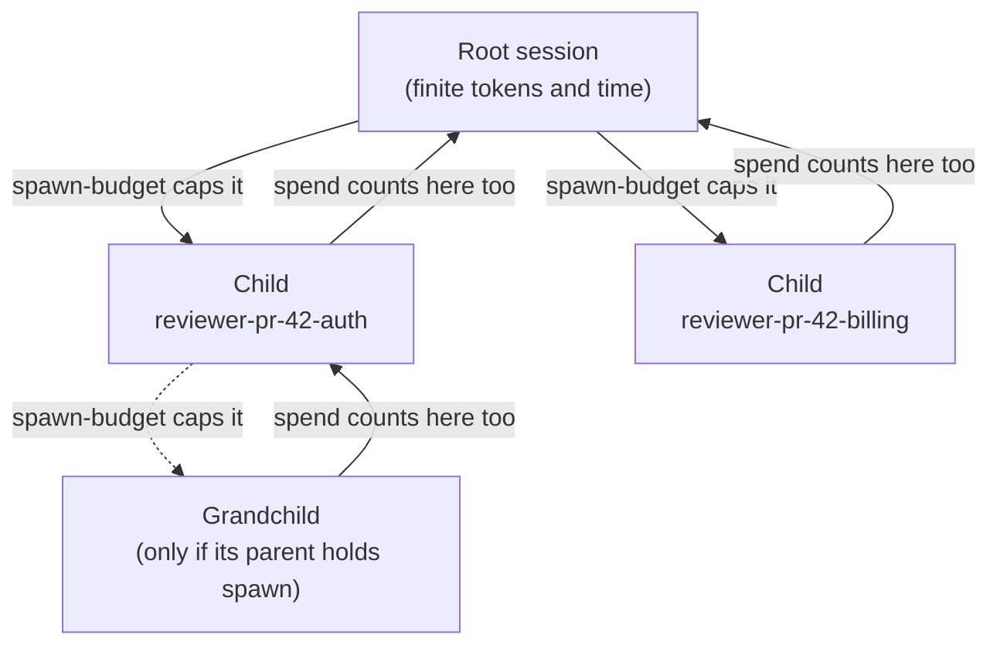
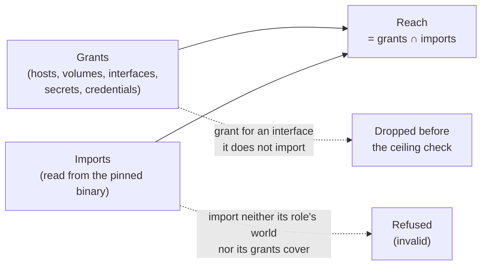
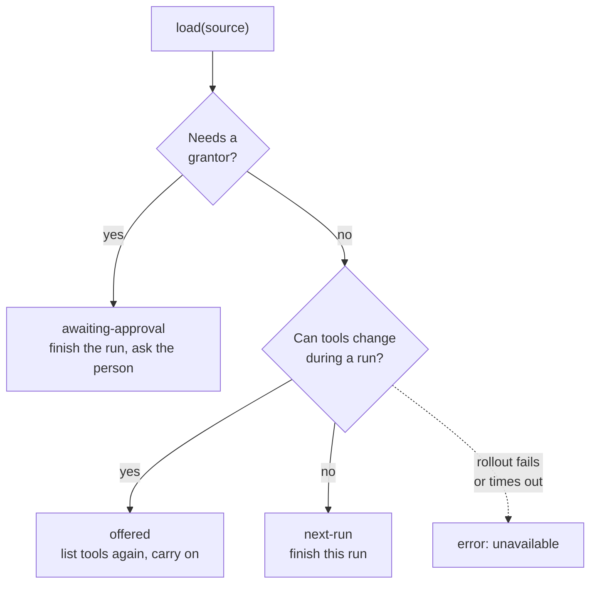
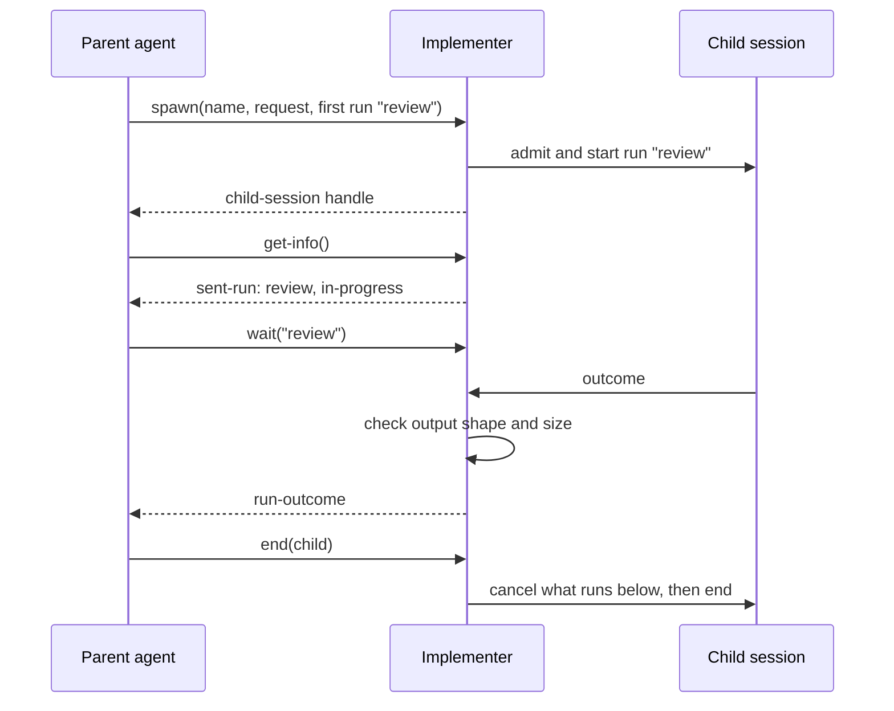

# Spawn and tool loading

An agent with a job often needs help it did not start with:
a tool it finds it needs halfway through a task,
or a second agent to review one file or to read content it should not trust.
These interfaces give it both.
**Tool loading** adds a tool component to the agent's own session while it works.
**Spawn** starts a child agent session (often called a subagent),
with its own model, tools and budget,
and collects what it returns.



A parent sets each child's budget when it spawns it,
and everything a session spends also counts against every session above it,
so a root's budget bounds its whole tree.

This page explains the model and walks through common tasks.
[RATIONALE.md](RATIONALE.md) explains why the design is what it is,
and [CONFORMANCE.md](CONFORMANCE.md) says what a host and an implementer must do.

## Glossary

| Term | Meaning |
| --- | --- |
| Tool | One function the model can call, such as `read_file`. |
| Tool component | One component, with its own grants, that offers tools: a tool provider (exports `cosmonic:agent/tools`) or a typed tool (exports its own interfaces). |
| Session | The conversation that persists across runs, identified by a session id. |
| Run | One call of `run` on a session, from an incoming message to an outcome, with any number of model and tool calls between. |
| Child | A session another session spawned, running in its own workload and inheriting nothing. |
| Session tree | A root session and every session spawned below it, which works like an OS process tree: each session has one parent, and its children and their descendants sit below it. |
| Reach | What a component can actually touch: its grants, limited to the interfaces it imports. |
| Ceiling | What a caller may add without asking anyone: its own reach plus tool components already approved for it. |
| Grantor | Whoever may approve a request beyond a ceiling: policy, an auditor, or a person. |
| Implementer | Whatever serves these interfaces to the agent, for example a host plugin. |

## How it fits together

### Reach comes from the binary

What a component may touch is decided before it runs,
from two things a grantor can be shown:



A grant for an interface the component does not import adds nothing, so it is dropped.
Imports are also covered by the component's role:
an agent may import what the `agent` world offers and the powers its parent gave it,
while a tool component gets only function-less type interfaces (CONFORMANCE 3.3).
An import that neither its role nor its grants cover means the component is refused.
A tool that cannot open a socket is then a property of the binary, not a promise.
An agent loads, sets aside or hands to a child a whole tool component, never a single tool,
because reach and approval belong to the component.

### What `load` returns

`load` resolves once there is something to act on, so a caller never polls:



A catalog tool component within the caller's ceiling needs no grantor.
`load` also answers with an error when it is refused or malformed (`load-error`).

### Delegating to a child

A parent hands a child a task and later collects one outcome.
It never sees the child's tool calls or conversation:



`spawn` resolves as soon as the request is accepted,
so the parent can do other work and wait later, even from a later run.

A parent reads two things about a child in its `session-info`.
`state` says where the child stands; once admitted, it is `live`
with the child's `session-status`:
what is in progress, whether it holds something for a person,
and how its last run ended, whoever started it.
`sent-run` says how the last run this parent sent there stands, as the parent sees it,
including endings only the parent sees, such as `withheld` or `expired`.

## Interfaces

Each power is its own import, so a component's world says exactly what it may do.

| Interface | The agent may |
| --- | --- |
| `tool-discovery` | ask which tool components are available |
| `tool-loading` | load tool components into itself and set them aside |
| `session-tree` | read the session tree it belongs to: where it sits, its remaining budget, and the sessions below it (every spawned child may) |
| `spawn` | start child agent sessions and drive them |

Reading the session tree and acting on it are separate powers:
`session-tree` only reads, and `spawn` is the only power that acts.

These interfaces come with no worlds of their own:
a component imports the ones it needs into its own world,
so the import list shows exactly which powers it holds.

| Component | Usually imports | Exports |
| --- | --- | --- |
| An agent that finds and loads its own tools | `tool-discovery`, `tool-loading` | `run` |
| An agent that delegates to children | `spawn`, `session-tree` | `run` |
| A spawned child | `session-tree`, and the powers its parent gave it | `run` |
| A component that watches a subtree without driving it | `session-tree` | |
| An implementer or a test double | | the interfaces it serves, and `tools` with `tool-loading` |

An agent builds on `runnable-agent` and adds the powers it needs:

```wit
package acme:coder@1.0.0;

world coder {
    include cosmonic:agent/runnable-agent@0.4.4;

    import cosmonic:agent/tool-loading@0.4.4;
    import cosmonic:agent/session-tree@0.4.4;
    import cosmonic:agent/spawn@0.4.4;
}
```

## Guides

Section numbers below refer to [CONFORMANCE.md](CONFORMANCE.md).

### Find a tool and use it in the same run

Goal: discover a tool component, load it, and call its tools before the run ends.

```rust
// Offers arrive on a stream, best match first.
let (mut offers, done) = tool_discovery::list_offers(Some("archive".into())).await;
let Some(offer) = offers.next().await else {
    done.await?; // the stream ended empty: an error, or nothing matched
    return Err(NoTool);
};
drop(offers); // the best match is enough; dropping the stream stops the listing
// offer.imports lists what it can call: here, the filesystem only.

let source = ToolComponentSource::Catalog(CatalogEntry { name: offer.name.clone() });
let done = tool_loading::load(source).await?;
match done.tool_component.state {
    ToolComponentState::Offered => {
        let tools = tools::list().await?; // the new tools are listed now
        // ...carry on with this run's next model call
    }
    ToolComponentState::NextRun => { /* finish this run; the tools arrive on the next */ }
    ToolComponentState::AwaitingApproval(p) => { /* finish the run asking the person: p.summary */ }
    _ => {} // `other`: a state this version does not name
}
// A rollout that fails or runs out of time is an error (`unavailable`).
```

What happens:

- The caller reads as many offers as it wants; nothing caps the listing but the caller.
  An error before any offer, or midway, ends the stream and arrives on the future (5.3).
- Within the caller's ceiling, a catalog tool component loads without asking
  and serves the run in progress (6.2, 3.16).
- Beyond it, `load` returns `awaiting-approval` at once rather than waiting (4.2).
- A person's approval lasts for the session:
  setting the tool component aside and loading it again needs no prompt,
  until the person removes it (2.7, 4.2).

### Stay within the model's function budget

Goal: load another tool component when the model is offered nearly as many functions as it handles well.

```rust
fn catalog(name: &str) -> CatalogEntry { CatalogEntry { name: name.into() } }

let set = tool_loading::list_loaded().await?;
// set.offered_functions = 125, set.max_offered_functions = Some(128)

let done = tool_loading::load(ToolComponentSource::Catalog(catalog("git"))).await?;
// done.set_aside = ["archive"]: set aside to make room; its component and approval stay.

tool_loading::load(ToolComponentSource::Catalog(catalog("archive"))).await?; // back at once
tool_loading::set_aside("git".into()).await?;                       // ready, still approved
```

What happens:

- The function budget comes from the model binding;
  the WIT fixes no number, and 128 here is only an example (6.5).
- When a load would go over it,
  the implementer sets aside the least recently called tool component the agent loaded,
  never one the workload declared or a person added (6.6).
- A set-aside tool component is `ready`: loading it again returns it to `offered` at once,
  after the same checks, setting another aside if the budget needs room.

### Delegate a review to children

Goal: have two reviewers work on parts of a pull request at once,
and get a typed verdict from each.

```rust
#[derive(Deserialize, JsonSchema)]
struct Review { risks: Vec<String>, verdict: Verdict }

let request = SpawnRequest {
    agent: AgentSource::Custom(AgentSpec {
        component: pinned("ghcr.io/acme/agents/reviewer:1.2.0", "sha256:9f…"),
        model_alias: "frontier".into(),
        grants: Grants::none(),
        tool_components: vec![ToolComponentSource::Catalog(catalog("repo-fs-readonly"))],
    }),
    instructions: "Review the PR and list risks.".into(),
    output: OutputShape::ReplyAndStructured(schema_for::<Review>()),
    max_output_bytes: 16_384, // caps each run's encoded outcome
    budget: SpawnBudget { max_runs: Some(3), max_steps: Some(12), ..Default::default() },
    powers: AgentPowers::empty(),
};
// Child and run names are 1 to 64 characters of [a-z0-9-].
let first = |msg: &str| Some(FirstRun { run: "review".into(), message: user(msg) });

// Two reviewers start and work at once; neither waits on the other.
let (auth, billing) = futures::join!(
    spawn::spawn("reviewer-pr-42-auth", request.clone(), first("Review the auth changes.")),
    spawn::spawn("reviewer-pr-42-billing", request, first("Review the billing changes.")),
);
let (auth, billing) = (auth?, billing?);

let info = auth.get_info().await?;
// info.name = Some("reviewer-pr-42-auth"), info.session_id = "ses-8c1f…",
// info.sent_run = Some(("review", RunState::InProgress))

let (a, b) = futures::join!(auth.wait("review"), billing.wait("review"));
let (auth_review, billing_review): (Review, Review) = (a?.structured()?, b?.structured()?);
futures::try_join!(ChildSession::end(auth), ChildSession::end(billing))?;
```

What happens:

- A child takes one run at a time, so work that should run in parallel goes to separate children.
- The parent names each child and each run, and a name is also an idempotency key:
  spawning `reviewer-pr-42-auth` again returns the same child,
  and sending run `review` to it again returns the same run (7.7, 7.9).
  The implementer assigns the child's session id.
- If the request needs a grantor,
  the child waits in state `pending` and its first run as `blocked(admission)` (7.2).
- The parent sees contentless progress and the final outcome, never a reviewer's tool calls or conversation;
  an outcome over `max-output-bytes` fails `output-rejected` (7.14).

### Collect children's results in a later run

Goal: start long work in one run, end that run, and pick up the results in a later one.

```rust
// Run 1: start three researchers and end this run.
for topic in ["pricing", "competitors", "regulation"] {
    let c = spawn::spawn(&format!("research-{topic}"), request_for(topic),
        Some(FirstRun { run: "r1".into(), message: user(topic) })).await?;
    drop(c); // releases the reference; the child keeps working
}

// Run 2, maybe on another machine: where does each stand?
for info in session_tree::list_children(ChildQuery { descendants: false }).await? {
    // info.name = Some("research-pricing"), info.session_id = "ses-41d2…",
    // info.sent_run = Some(("r1", RunState::Done))
    if let Some((run, RunState::Done)) = &info.sent_run {
        let child = spawn::get_child(info.name.as_deref().unwrap()).await?;
        let notes = child.wait(run).await?;
        // ...
    }
}
```

What happens:

- Dropping a handle releases the reference only;
  `get-child` finds the child again by name from any later run (7.8, 7.17).
- `watch-children` streams the same records within a run (11.2).
- If a child's machine is lost mid-run, its `sent-run` becomes `failed(host-lost)` rather than hanging,
  and a later `send` starts a new run (8.2).
- `cancel` and `end` reach everything below the child (section 9).

### Read untrusted content in quarantine

Goal: have a child read an untrusted message and return only a small, validated value.

```rust
let reader = SpawnRequest {
    agent: AgentSource::Catalog(catalog("quarantine-reader")), // imports only chat
    output: OutputShape::StructuredOnly(schema_for::<Triage>()), // no free strings
    max_output_bytes: 256,
    budget: SpawnBudget { max_runs: Some(1), max_steps: Some(1), ..Default::default() },
    ..base
};
let child = spawn::spawn("triage-msg-881", reader,
    Some(FirstRun { run: "triage".into(), message: user(&untrusted_email) })).await?;
let triage: Triage = child.wait("triage").await?.structured()?;
```

What happens:

- With `structured-only`, the parent receives only the validated structured value;
  every other outcome field is the implementer's own (7.14).
- The reader imports nothing beyond `chat`, which the approver can see,
  and its prompts reach only its model's provider:
  use a model binding without provider-run tools (3.8).
- An import list shows what a component can call directly, not where data flows.
  This narrows what a manipulated child can do and say;
  it does not stop it being manipulated.

## Using the unstable features

**Status: unstable.** These interfaces are part of `cosmonic:agent` 0.4.4 and may change before they are marked `@since`.

- Tool discovery and loading are behind the `agent-tool-loading` feature.
- The session tree and spawn are behind `agent-spawn`,
  which also needs `agent-tool-loading`, `agent-run` and `session-status`.

For wit-bindgen, list the features you need
(`features: ["agent-tool-loading", "agent-spawn", "agent-run", "session-status"]`).
A Wasmtime host sets the same options on the `LinkOptions`
its generated `add_to_linker` takes.

## Files

| File | Contents |
| --- | --- |
| [`tool-component-types.wit`](../../tool-component-types.wit) | Grants, tool component sources and states |
| [`tool-discovery.wit`](../../tool-discovery.wit) | `tool-discovery` |
| [`tool-loading.wit`](../../tool-loading.wit) | `tool-loading` |
| [`spawn-types.wit`](../../spawn-types.wit) | Child state, runs, budgets |
| [`session-tree.wit`](../../session-tree.wit) | `session-tree` |
| [`spawn.wit`](../../spawn.wit) | `spawn` and the `child-session` resource |
